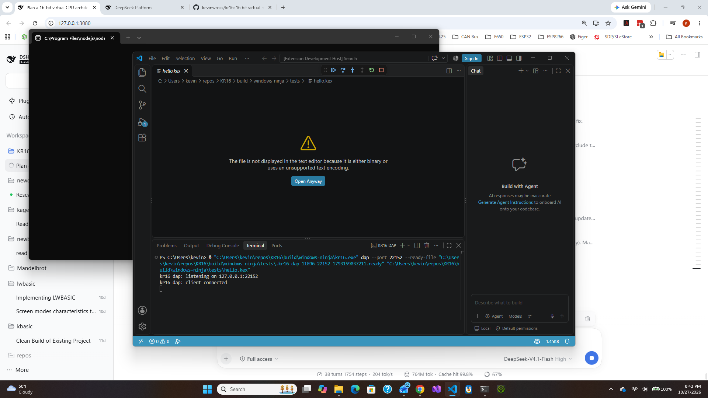

# Debugging KR16 programs in VS Code

The KR16 VS Code extension connects the editor's debugger to the `kr16 dap`
server. You set breakpoints on your C or assembly source, step through the
program, and inspect registers, locals, globals, and the call stack, all inside
VS Code. The extension source lives in [vscode/](vscode) and is versioned
alongside the toolchain.



## What you get

From the Run and Debug view:

- Launch a `.kex` image, or attach to a `kr16 dap` server you started yourself.
- Source-line breakpoints, plus function-entry breakpoints by name.
- Continue, pause, step in, step over, and step out.
- A multi-frame call stack.
- `Registers`, `Globals`, and `Locals` variable scopes.
- A Debug Console for register and memory-address expressions.

From the Command Palette:

- **KR16: Debug Program** asks for an image path and starts a session.
- **KR16: Show Disassembly** opens a read-only disassembly around the current
  PC, beside your source. It refreshes on every stop while it is open.

The adapter answers `initialize`, `launch`, `attach`, `setBreakpoints`,
`setFunctionBreakpoints`, `configurationDone`, `threads`, `stackTrace`,
`scopes`, `variables`, `readMemory`, `disassemble`, `evaluate`, `continue`,
`pause`, `next`, `stepIn`, `stepOut`, `terminate`, and `disconnect`.
Conditional breakpoints, hit counts, step back, restart, and `setVariable` are
not implemented.

## Prerequisites

- VS Code 1.80 or newer.
- A built `kr16` executable — see [README.md](README.md#build). The presets put
  it at `build/windows-ninja-release/kr16.exe` (Windows) or
  `build/linux-gcc-release/kr16` (Linux).
- Node.js 18+ and npm, only if you package the `.vsix` yourself.
- A program built with debug information (see below).

The extension runs `kr16` itself, so either put the executable on `PATH` or
point `kr16Path` at it in `launch.json` (shown below).

## Build a debuggable image

`kr16 build` records debug information by default, so this is enough:

```text
kr16 build tests/kevin/bigtest.c
kr16 vm tests/kevin/bigtest.kex
```

That writes `bigtest.s`, `bigtest.o`, `bigtest.libc.o`, and `bigtest.kex` next
to the source. The `.kex` carries `.debug_line`, `.debug_sources`, and the
compiler's variable and frame records — which is what turns a source line into
an address.

Two things to avoid:

- `kr16 build --no-debug` (or `cc`/`as` without `-g`) produces an image with no
  line table. The program still runs, but source breakpoints stay unverified:
  `kr16 debug bigtest.kex --lines` prints `no line table` for such a build.
- Debugging a stale `.kex` is confusing. Rebuild after editing the source.

## Install the extension

### Option 1: build the VSIX and install it

From the repository root:

```powershell
cd vscode
npx --yes @vscode/vsce package
```

This writes `vscode/kr16-debug-1.2.0.vsix` (version comes from
[vscode/package.json](vscode/package.json)). The `*.vsix` file is git-ignored.

Install it from the command line:

```powershell
code --install-extension vscode\kr16-debug-1.2.0.vsix
```

On Linux or macOS the path is `vscode/kr16-debug-1.2.0.vsix`.

Or install from the UI: open the Extensions view, click the `…` menu, choose
**Install from VSIX…**, and select the file.

Verify the install:

```text
> code --list-extensions --show-versions
kr16.kr16-debug@1.2.0
```

If VS Code was already running when you installed, reload the window
(`Ctrl+Shift+P` → **Developer: Reload Window**) so the extension activates.

### Option 2: run it from source, without installing

Useful while editing the extension:

```powershell
code --extensionDevelopmentPath="C:\Users\kevin\source\repos\kr16\vscode"
```

That opens an Extension Development Host with this extension loaded and no
installation step. The extension has no runtime dependencies; `npm install` in
`vscode/` is only needed to run its own test (`npm test`).

### About `scripts/package.ps1`

The release script copies an **already built** `vscode/kr16-debug-<version>.vsix`
into the distribution zip. It does not run `vsce`, so package the `.vsix` first
if you want it included in a release.

## Configure a launch profile

Create `.vscode/launch.json` in the workspace (it is git-ignored locally). A
Windows profile that points at the build from this repository:

```json
{
  "version": "0.2.0",
  "configurations": [
    {
      "type": "kr16",
      "request": "launch",
      "name": "Debug bigtest.kex",
      "program": "${workspaceFolder}/tests/kevin/bigtest.kex",
      "kr16Path": "${workspaceFolder}/build/windows-ninja-release/kr16.exe",
      "stopOnEntry": true
    }
  ]
}
```

On Linux, change `kr16Path` to
`${workspaceFolder}/build/linux-gcc-release/kr16`. If `kr16` is already on
`PATH`, omit `kr16Path` entirely.

| Property | Default | Meaning |
| --- | --- | --- |
| `program` | — (required) | Path to the `.kex` or raw image; prefer `${workspaceFolder}/…` |
| `kr16Path` | `kr16` | Executable the extension spawns; absolute path is safest |
| `port` | `22152` | TCP port for the DAP server on `127.0.0.1` |
| `args` | `[]` | Extra arguments passed to `kr16 dap` after the image path |
| `stopOnEntry` | `true` | Stop before the first instruction and report the entry |
| `launchAdapter` | `true` | Spawn `kr16 dap`; set `false` to attach to a running server |

`stopOnEntry` is honoured through the DAP launch request, so it works even
though the extension does not turn it into a command-line flag.

`args` is how you reach the rest of the `kr16 dap` options:

```json
{
  "type": "kr16",
  "request": "launch",
  "name": "Debug raw image",
  "program": "${workspaceFolder}/build/program.bin",
  "args": ["--raw", "--base", "0x100"]
}
```

```json
{
  "type": "kr16",
  "request": "launch",
  "name": "Debug with a custom BIOS",
  "program": "${workspaceFolder}/build/program.kex",
  "args": ["--bios", "${workspaceFolder}/build/bios.bin"]
}
```

The adapter uses the embedded BIOS by default; `--bios` overrides it with a ROM
you pass in, and `--no-bios` starts directly at the entry point instead. A ROM
is a raw 3.75 KiB image, built from the assembly source the same way the tests
do it:

```text
kr16 as resources/bios.s -o build/bios.bin --raw --base 0xF100
```

`${workspaceFolder}` is expanded by VS Code before the arguments reach the
terminal, so it is safe inside `args`.

## Start a session

Press `F5`, or open Run and Debug and pick the configuration.

The extension opens a terminal named **KR16 DAP**, runs

```text
kr16 dap --port 22152 --ready-file <dir>/.kr16-dap-….ready <program> [args...]
```

The readiness marker is written next to the program, and the extension waits for
it before connecting. So:

- **Program output appears in the KR16 DAP terminal**, not in the Debug
  Console. That separation is deliberate; the VM's stdout and the debug
  protocol stay apart.
- If the server never becomes ready, the extension reports *"DAP server did not
  become ready on 127.0.0.1:22152; check the KR16 DAP terminal"*. The terminal
  shows why — usually `kr16` was not found or the port is taken.
- The server accepts exactly one client, so the extension waits for the marker
  file instead of probing the port.
- A single continue or step is capped at 1,000,000 instructions. If a program
  spins forever, the adapter reports a paused stop rather than hanging.

## Breakpoints

- **Source lines**: click the gutter next to a statement in a file that was
  compiled with `-g`. A solid red dot means the line resolved to an address; a
  hollow or grey circle means it did not (rebuild with debug info).
- **Functions**: in the Breakpoints panel choose **Add Function Breakpoint** and
  type a symbol name, for example `main` or `printf`. Names resolve through the
  image symbol table.
- **Conditions and hit counts** are not supported. VS Code may let you type them
  but the adapter reports the capability as false, so leave them empty.

## Inspect state

The Variables view lists three scopes:

| Scope | Contents |
| --- | --- |
| `Registers` | R0–R4, SP, SR, PC, shown in hex |
| `Globals` | Symbols that live in `.data` or `.bss`, read as 16-bit words |
| `Locals` | Local variables of the frame at the current PC |

`Globals` is built from the image symbol table, so it works for any image that
keeps symbols; a stripped image shows nothing there. `Locals` comes from the
compiler's `.debug_vars` and `.debug_frames` records and only appears when the
current PC is inside a function compiled with `-g`. Frames beyond the innermost
one are walked through the frame-pointer chain.

The Debug Console evaluates a small set of expressions:

| Expression | Result |
| --- | --- |
| `$pc`, `$sp`, `$sr` | Program counter, stack pointer, status register |
| `$r0` … `$r4` | General-purpose register |
| `0x1234`, `4660` | The literal value |
| `$syscalls`, `$syscall_trace` | Host-service trace text |

Arbitrary C expressions and variable names are not evaluated; use the Variables
view for those.

## Disassembly

With a KR16 session running, either use the disassembly button in the debug
toolbar or run **KR16: Show Disassembly** from the Command Palette. It opens a
read-only `asm` document beside your source, listing 80 instructions from the
current PC with a `>` marker on the instruction that is about to execute, and
rewrites itself on every stop through the adapter's `kr16.stopped` event. Close
the document to stop the refresh.

This is a snapshot document, not VS Code's native disassembly view; the
disassembly is produced by the adapter's `disassemble` request.

## Attach to a server you started

Start the server yourself:

```text
kr16 dap --port 22152 --no-stop-on-entry build/program.kex
```

and point a configuration at it:

```json
{
  "type": "kr16",
  "request": "attach",
  "name": "Attach to KR16 DAP",
  "program": "${workspaceFolder}/build/program.kex",
  "port": 22152,
  "launchAdapter": false
}
```

With `launchAdapter: false` the extension does not spawn anything; it connects
to `127.0.0.1:<port>` and waits for the server to accept. `request` may be
`launch` or `attach` — both reach the same handler.

## Check the adapter without VS Code

The integration smoke test speaks DAP directly:

```text
node scripts/dap-smoke.js build/windows-ninja-release/kr16.exe tests/kevin/bigtest.kex
```

It starts `kr16 dap`, sets a breakpoint, continues, and checks the stopped
events. `ctest --preset windows-ninja-release -R dap` runs the same check.

## Troubleshooting

| Symptom | Likely cause | Fix |
| --- | --- | --- |
| `KR16: DAP server did not become ready…` | `kr16` not found, wrong `kr16Path`, or port in use | Read the KR16 DAP terminal; set an absolute `kr16Path`; change `port` |
| `KR16: the launch configuration needs a "program" path` | `program` missing | Add it to `launch.json` |
| `EADDRINUSE`/bind failure in the terminal | Another session is using port 22152 | Pick another port in `launch.json` |
| Breakpoints stay unverified | Image built without `-g` | Rebuild with `kr16 build` (or drop `--no-debug`) |
| Breakpoints verify but never hit | Stale `.kex`, or the line maps to an address the flow skips | Rebuild; check `kr16 debug <image> --lines` |
| `Locals` scope missing or empty | Image built without `-g`, or the PC is outside a known function | Rebuild with debug info |
| `Globals` empty | Image was stripped, so `.data`/`.bss` symbols are gone | Link without `ld --strip` |
| Program output missing | It goes to the KR16 DAP terminal | Look at that terminal, not the Debug Console |
| Session pauses "by request" on its own | A `continue` hit the 1,000,000-instruction guard | Add a breakpoint before the loop, or fix the loop condition |
| Commands are missing after install | Window not reloaded | **Developer: Reload Window** |

## Update and uninstall

```powershell
code --install-extension vscode\kr16-debug-1.2.0.vsix --force
code --uninstall-extension kr16.kr16-debug
```

Re-run `npx @vscode/vsce package` after changing `vscode/extension.js` or
`vscode/package.json`; bump `version` in `package.json` when you want VS Code to
see it as a new release.
