# KR16 Windowed UI Integration Plan

Status: accepted design. Phase 0, the Win32 product window, the SDL3 Linux
backend (x64 and ARM64), embedded fonts/resources, and both AppImages are
implemented and verified locally; only the GitHub tag publish remains.

The windowed debugger in `tools/mockup/` is approved as the KR16 UI. This plan
turns it into the product's no-argument window, keeps every existing CLI
command and the DAP server, and adds a Linux x64/ARM64 backend.

## 1. Accepted decisions

| Area | Decision |
| --- | --- |
| UI baseline | The reference UI is the real UI. Keep its layout, controls, theme and behaviour. |
| GUI library | SDL3, statically linked. One software-rendered UI, no GPU requirement. |
| Windows binary | One console-subsystem `kr16.exe`. No arguments spawns a detached `kr16.exe --ui` child with no console. A brief console flash on Explorer double-click is accepted. |
| Windows CRT | `/MT` for KR16 and SDL3. No MSVC runtime DLLs. |
| Linux targets | x86-64 and ARM64. Ubuntu 22.04 baseline for the AppImage. |
| Linux release | AppImage per architecture with static SDL3 and embedded fonts. Plain dynamically linked ELF remains the development build. |
| Renderers | Win32 GDI on Windows, SDL3 on Linux. Same layout, colours, sizes and bundled fonts; minor text-rasterisation differences are accepted. |
| Fonts | JetBrains Mono + Inter, both OFL, subset and embedded. |
| File picker | SDL3 native dialog, with a small built-in fallback on Linux. |
| Startup | Empty UI. Drag/drop a `.kex`, `.c`, `.s`, `.asm` or `.o`; an existing file path as `argv[1]` opens it in the UI. `--ui` remains the internal child switch. |
| Build outputs | Keep CLI behaviour: generated `.s`, `.o` and `.kex` land next to the input file. |
| Headless | `kr16 shell` stays as an explicit fallback. No display plus no arguments prints help/error instead of starting a shell. |
| Counters | 64-bit instruction count and run-time-only timer. Load and Restart reset them; `Reset stats` zeroes them without changing program state. IPS = instructions / run seconds. |
| DAP | Keep the `dap` command and VS Code path. The UI uses the in-process session. |

## 2. Goals

- Make the approved UI the no-argument KR16 window on Windows and Linux.
- Preserve every CLI command, its output and exit codes.
- Reuse one portable debug model for the UI, tests and future front ends.
- Keep the engine, CLI and DAP independent of the UI.
- Produce a single Windows `.exe` and no-install Linux AppImages.
- Remove the reference-harness-only debug-info workarounds by fixing the data at
  its source.

Non-goals for this effort:

- changing the VM, ISA, container format or command syntax;
- source editing, conditional breakpoints or a full IDE;
- replacing DAP or removing the CLI;
- pixel-identical rendering between Windows and Linux.

## 3. Current state

The engine and CLI already build on Linux: the CMake presets and CI cover GCC
and Clang, and `CheckPlatformBoundary.cmake` keeps OS headers under
`src/platform/`.

`tools/mockup/kr16_mockup.cpp` is one ~3,800-line file that mixes:

1. Win32 window creation, GDI painting, input, timers and file dialogs;
2. UI state (layout, hover, editors, scrolling, counters);
3. the debug session (load, CPU, debug info, stepping, variables, memory);
4. product behaviour (compile/link-on-load, embedded libc, error dialogs).

The reference harness contains workarounds that must not become product
behaviour:

- source paths from `.debug_sources` with raw `\r`/`\n`/`\t`;
- out-of-order `.debug_line` rows dropped in the UI;
- prologue rows forced to line 0;
- breakpoint binding to the first address of a line;
- DAP stepping one instruction instead of a source line;
- call frames named `<program>`;
- only the first `.debug_line` section used;
- missing `.type`/`.size` information for aggregates.

## 4. Target architecture

```
include/kr16/debug_session.hpp     portable product debug model
src/debug/debug_session.cpp        session implementation

include/kr16/ui/geometry.hpp       Rect, Point, Size, Color
include/kr16/ui/canvas.hpp         drawing and text interface
include/kr16/ui/input.hpp          portable events
include/kr16/ui/window.hpp         window/platform services
src/ui/app.cpp                     layout, state, hit testing, painting
src/ui/help.cpp                    instruction and addressing help
src/ui/theme.cpp                   colours, spacing, fonts
src/ui/session_bridge.cpp          UI-facing session helpers, if needed

src/platform/ui/win32/             Win32 window, GDI canvas, dialogs, clock
src/platform/ui/sdl/               SDL3 window, software canvas, dialogs, clock
```

The dependencies point one way:

```
CLI / DAP ──► kr16_core ──► DebugSession
                         ▲
UI ──► Canvas/Input/Platform interfaces
        ▲
Win32 backend / SDL3 backend
```

`src/ui` must not include `windows.h`, `SDL3.h`, GDI types, `RECT`, `HDC` or
`COLORREF`. Public UI text is UTF-8; no `wchar_t` crosses the interface.

## 5. Portable interfaces

### Geometry and painting

```cpp
struct Point { int x; int y; };
struct Size { int width; int height; };
struct Rect { int left, top, right, bottom; };
struct Color { std::uint8_t r, g, b, a; };

enum class FontRole { Ui, UiBold, Mono, MonoSmall };

class Canvas {
public:
    virtual ~Canvas() = default;
    virtual void fill_rect(const Rect&, Color) = 0;
    virtual void frame_rect(const Rect&, Color, int thickness = 1) = 0;
    virtual void text(int x, int y, std::string_view utf8, Color,
                      FontRole) = 0;
    virtual Size measure(std::string_view utf8, FontRole) = 0;
    virtual int line_height(FontRole) = 0;
    virtual void push_clip(const Rect&) = 0;
    virtual void pop_clip() = 0;
};
```

Alignment helpers live in the UI layer, built from `measure`.

### Input

```cpp
enum class Key { Unknown, Enter, Escape, Up, Down, Left, Right,
                 Home, End, PageUp, PageDown, F5, F6, Tab, Backspace,
                 Delete };

struct KeyEvent { Key key; bool ctrl; bool shift; bool alt; };
struct TextEvent { std::string utf8; };
struct MouseEvent { Point position; int button; int wheel; };
struct ResizeEvent { Size size; };
struct FocusEvent { bool focused; };
struct TimerEvent {};

using Event = std::variant<MouseEvent, KeyEvent, TextEvent,
                           ResizeEvent, FocusEvent, TimerEvent>;
```

The platform delivers logical-pixel coordinates; DPI scaling belongs to the
backend.

### Window and platform services

```cpp
using FileCallback =
    std::function<void(std::optional<std::filesystem::path>)>;

class Window {
public:
    virtual ~Window() = default;
    virtual void invalidate() = 0;
    virtual void set_title(std::string_view) = 0;
    virtual void set_timer(int milliseconds, bool enabled) = 0;
    virtual void open_file(FileCallback, std::string_view title,
                           std::string_view filter) = 0;
    virtual void show_error(std::string_view title,
                            std::string_view message) = 0;
    virtual void set_cursor(CursorKind) = 0;
    virtual void request_close() = 0;
};
```

The Win32 backend implements `Canvas` with GDI and `Window` with a message
loop. The SDL3 backend implements `Canvas` with a software pixel buffer and
`Window` with SDL events. The UI owns no handles and no OS state.

## 6. DebugSession

`DebugSession` is product logic, not a UI detail, so it lives in core and is
tested without a window. Proposed surface:

```cpp
enum class StepMode { Instruction, LineOver, LineIn, LineOut };

struct SessionInstruction {
    std::uint16_t address;
    std::uint8_t size;
    std::string text;
    std::vector<std::uint8_t> bytes;
};

struct SessionSourceLine { std::string text; bool executable; };
struct SessionFunction { std::string name; std::uint16_t low, high; };
struct SessionFrame { std::uint16_t pc; int line; std::string name; };
struct SessionVariable {
    std::string name, scope;
    std::uint16_t address, value;
    int size;
    bool local, ok;
};

class DebugSession {
public:
    bool load(const std::filesystem::path&, std::string& error);
    bool build_and_load(const std::filesystem::path&, std::string& error);
    void restart();

    bool step_instruction();
    bool step_line(StepMode);
    bool run_until_breakpoint();
    void start_run();
    void stop_run(std::string reason);

    std::uint16_t pc() const;
    std::uint16_t sp() const;
    std::uint16_t sr() const;
    std::uint16_t reg(int) const;
    void set_reg(int, std::uint16_t);
    std::uint8_t read8(std::uint16_t);
    void write8(std::uint16_t, std::uint8_t);

    const std::vector<SessionInstruction>& instructions() const;
    const std::vector<SessionSourceLine>& source_lines() const;
    const std::vector<SessionFunction>& functions() const;
    std::vector<SessionFrame> frames() const;
    std::vector<SessionVariable> locals() const;
    std::vector<SessionVariable> globals() const;

    int line_at(std::uint16_t) const;
    const SessionFunction* function_at(std::uint16_t) const;
    const std::string& console() const;

    void toggle_line_breakpoint(int);
    void toggle_address_breakpoint(std::uint16_t);
    const std::set<int>& line_breakpoints() const;
    const std::set<std::uint16_t>& address_breakpoints() const;

    std::uint64_t instructions_executed() const;
    std::uint64_t run_time_ms() const;
    void reset_stats();
};
```

Implementation rules:

- Load `.kex` with `Container::read`; validate sections and entry.
- Own `Machine`, `Cpu`, `Container`, symbols, lines, functions, variables and
  console. The UI receives values, never references to CPU internals.
- Build-on-load calls `build_program` with `link_libc = true` for `.c`, and
  captures diagnostics into a string instead of stderr.
- Embedded `libc.s` is generated into a header at build time. No `%TEMP%`
  staging.
- Source paths are cleaned once, at debug-info parse time. No UI repair.
- Instruction stepping is the primitive; source-line stepping is built on it.
- The UI's run timer calls `run_slice()`; the session does not own an OS timer.

## 7. Entry points

### Windows

`kr16.exe` is a console-subsystem executable:

- normal commands run in the parent, unchanged;
- no arguments (`argc == 1`) spawn the same executable with `--ui` using
  `CreateProcessW` and `CREATE_NO_WINDOW`, close the handles and exit;
- the child has no console and creates the SDL window;
- `--ui [path]` is an internal switch, not part of the help text;
- the child reports fatal UI errors with a message box and a log file.

### Linux

`kr16` is one ELF. No arguments runs the UI in-process; a terminal launch
blocks until the window closes, which is normal for a GUI program.

## 8. Build system

Add:

```cmake
option(KR16_BUILD_UI "Build the windowed debugger UI" ON)
```

- `kr16_core` gains `src/debug/debug_session.cpp`.
- `kr16_ui` is a static library containing `src/ui`.
- Windows sources add `src/platform/ui/win32` and link `user32 gdi32
  comdlg32 shell32`.
- Linux sources add `src/platform/ui/sdl` and link static SDL3 plus `dl`,
  `m`, `pthread`.
- `kr16` links `kr16_ui`; tests link `kr16_core` and `kr16_ui`.
- `KR16_BUILD_UI=OFF` must still build and test the CLI and DAP headlessly.

SDL3 is fetched with `FetchContent` pinned to a release tag and `URL_HASH`.
`KR16_SDL3_SOURCE_DIR` overrides it for offline builds. On Windows, SDL3 is
built with `SDL_SHARED=OFF`, `SDL_STATIC=ON`, `SDL_TEST=OFF` and `/MT`.

Fonts and `libc.s` are generated into `.cpp`/`.hpp` arrays by CMake custom
commands, so the binaries need no resource files at runtime.

## 9. Linux backend

- SDL3 video and events; software surface or software renderer; no OpenGL.
- One software canvas backed by an RGBA surface; text is rasterised from
  embedded TTFs with stb_truetype into an atlas.
- Native `SDL_ShowOpenFileDialog`; if the portal is unavailable, fall back to
  a small built-in directory browser.
- High-DPI: SDL logical coordinates; the backend scales the canvas.
- Keyboard: SDL keycodes plus `SDL_EVENT_TEXT_INPUT`; no Win32 virtual keys in
  the UI.
- Clock: one monotonic millisecond clock in the platform layer.
- CI smoke test under Xvfb; UI event injection through the portable event
  interface, not `SendMessage`.

## 10. Fonts and resources

- JetBrains Mono for code and numeric columns.
- Inter for UI labels, buttons and help text.
- Subset to Latin, digits, punctuation and the symbols the UI uses.
- Commit the OFL licence files and add both fonts to `THIRD_PARTY_NOTICES.md`.
- Embed regular and bold weights only; keep the executable small.

## 11. Packaging

Windows:

- one `kr16.exe`, static SDL3 and `/MT`;
- no SDL3.dll, no MSVC runtime DLLs;
- verify with `dumpbin /DEPENDENTS`.

Linux:

- development: one dynamically linked ELF with static SDL3;
- release: AppImage per architecture, built on Ubuntu 22.04;
- x86-64 and ARM64; ARM64 CI is native if available, otherwise
  `aarch64-linux-gnu` cross-build plus QEMU smoke tests;
- AppImage includes desktop file, icon and font licences.

## 12. Testing

- `DebugSession` unit tests: load, disassembly, bytes, registers, memory,
  breakpoints, instruction/line stepping, frames, locals/globals, console,
  reset, counters.
- UI layout tests: rectangles, hit targets, hover regions and tooltip wrapping
  without a window.
- Windows UI smoke tests: existing synthetic mouse/keyboard harness and
  screenshots.
- Linux UI smoke tests: Xvfb plus SDL event injection; screenshots optional.
- CLI regression: every command's help, output and exit code unchanged.
- No-argument UI test gated on a display; headless test checks the no-display
  error path.

## 13. Phases

### Phase 0 — session and interfaces

- Add `DebugSession` to core with load, memory, registers, disassembly,
  instruction stepping and breakpoint tests.
- Add line/source/variable/frame support and build-on-load.
- Fix source-path escaping and `.debug_line` ordering in the assembler/debug
  info; remove the UI workarounds.
- Add `include/kr16/ui` interfaces and `src/ui` skeleton.
- Add `KR16_BUILD_UI` and `kr16_ui` build targets.
- Acceptance: Linux and Windows core tests pass; the UI skeleton builds with a
  no-op backend; CLI/DAP unchanged.

### Phase 1 — Win32 parity

- Port the approved UI to `src/ui`, using the Win32 GDI backend.
- Replace direct CPU/machine access with `DebugSession`.
- Match current screenshots and all features: panes, registers, flags,
  variables, memory, bytes, help, load/build, run/break, counters.
- Remove the old reference harness from the product build.
- Acceptance: feature checklist and screenshots match; CLI/DAP tests pass.

### Phase 2 — Linux

- Add the SDL3 window/canvas backend, embedded fonts, native dialogs and
  fallback.
- Port keyboard/mouse/DPI/timer behaviour.
- Add Xvfb smoke tests.
- Acceptance: same feature checklist on Linux x64; no Windows-only code in
  `src/ui`.

### Phase 3 — packaging and ARM64

- Static SDL3 release builds; Windows single-exe dependency check.
- AppImage x64/ARM64; desktop integration; licences.
- ARM64 CI and smoke tests.
- Remove the shell from the default path (keep `kr16 shell`).
- Acceptance: release artifacts run on clean VMs; no installer.

## 14. Risks

- Static SDL3 and `/MT` must be built with the same runtime; verify each release.
- SDL3 native dialogs may need `xdg-desktop-portal`; the fallback must work.
- Text metrics differ between GDI and FreeType; layout must measure, not assume.
- Debug-info defects will surface immediately in the UI; fix them in core.
- ARM64 CI capacity may require cross-compilation.
- The single Windows exe has a short console flash unless a shortcut is used.
- AppImage FUSE may be unavailable; document
  `--appimage-extract-and-run`.

## 15. Definition of done

- `kr16` opens the approved UI on Windows and Linux x64/ARM64.
- All existing commands, help text and exit codes are unchanged.
- `kr16 shell` still works explicitly; no-argument headless prints help.
- Windows ships one `.exe` with no SDL/MSVC DLLs.
- Linux ships x64 and ARM64 AppImages.
- The debug session is tested without a window on Linux.
- No reference-harness-only debug-info workaround remains in the product.
- DAP still works with VS Code.

## 16. Progress log

### 2026-10-28 — Phase 0 start

- Wrote this plan and recorded the accepted decisions.
- Added `include/kr16/ui/geometry.hpp`, `canvas.hpp`, `input.hpp` and
  `window.hpp`; `src/ui` and `src/platform/ui` now document the boundary.
- Added the first `DebugSession` slice in core:
  - `.kex` load and section mapping;
  - instruction decoding with raw bytes and disassembly text;
  - register get/set, byte/word memory access;
  - single instruction stepping, instruction over/out, source-line stepping;
  - source lines, functions, frames, locals and globals;
  - line breakpoints, address breakpoints, run slices and halt handling;
  - build-on-load for `.c`, `.s`, `.asm` and `.o`;
  - instruction counter and microsecond-accurate run timer.
- Fixed `.file` path escaping in the compiler: Windows backslashes are emitted
  as `\\`, so the assembler no longer turns `\r`, `\n` or `\t` into control
  bytes. `DebugSession` no longer needs a source-path repair.
- Added `tests/unit/test_debug_session.cpp` and `tests/unit/test_ui.cpp`.
- Windows and Linux builds pass the full suite (Windows 30/30, Linux 29/29).

Remaining Phase 0 items:

- Fix `.debug_line` relocation ordering in the linker; `DebugSession` still
  drops backwards rows as a temporary guard.

### 2026-10-28 — Win32 backend and first product window

- Added `KR16_BUILD_UI` and the `kr16_ui` static library.
- Added the Win32 platform backend: GDI canvas, window loop, timers,
  mouse/keyboard events, native file dialog, cursor changes and errors.
- Added the first portable product window (`src/ui/app.cpp`) with source and
  disassembly panes, address breakpoints, registers/flags, variables, call
  stack, console, Load/Run/Break/Restart/Reset stats, F5/F6 and the counters.
- Added `kr16_ui_smoke` and verified `.kex` and `.c` loading, build-on-load,
  run, Break, console output and live counters.
- Windows 30/30 and Linux GCC 29/29 tests still pass.

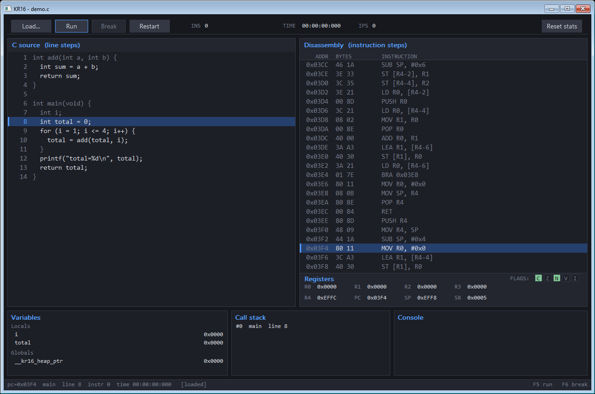

The `.debug_line` table still needs the linker relocation fix; the session
currently drops backwards rows and zeroes inherited prologue rows as temporary
guards. The visible effect is the correct first line at `main` (line 8).

### 2026-10-28 — stepping, line breakpoints and first parity pass

- Added C **Over / In / Out** and disassembly **Over / In / Out** buttons.
- Added source-gutter line breakpoints alongside disassembly address
  breakpoints.
- Fixed the first-line-at-`main` mapping (prologue rows are treated as line 0)
  and included `.crt0` in the disassembly so `_start` is visible.
- Verified C step-over advances from `main` line 8 to line 9, and a source
  line breakpoint stops execution on that line.
- The first product window now shows the approved top bar, both panes with
  step buttons, registers/flags, variables, call stack, console and status.

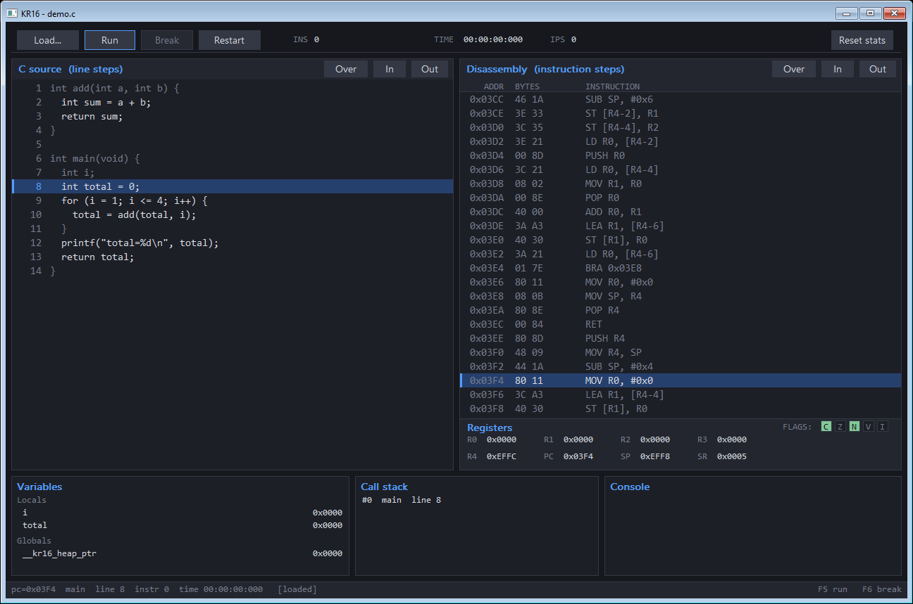

Parity work continued in the following entries; the Win32 window now has every
feature in the approved UI except the final release packaging.

### 2026-10-28 — memory strip

- Added the two-row memory strip at the bottom of the C pane, aligned with the
  registers.
- Address entry, wheel/arrow scrolling, per-byte hover tooltip and per-byte
  hex editing are working and verified.
- The C source pane now ends above the strip, matching the reference layout.

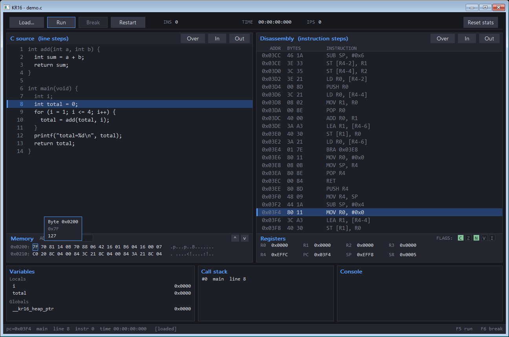

### 2026-10-28 — register and flag editing

- Registers are hoverable (name, hex and signed decimal) and editable in place;
  R0 was changed to `0x1234` and read back through the session.
- Status flags are clickable and render green when set.
- Register edits update the register strip immediately; SR is masked to the five
  flag bits.
- Added a shared hex editor with Enter/Escape/Backspace handling for memory and
  register fields.

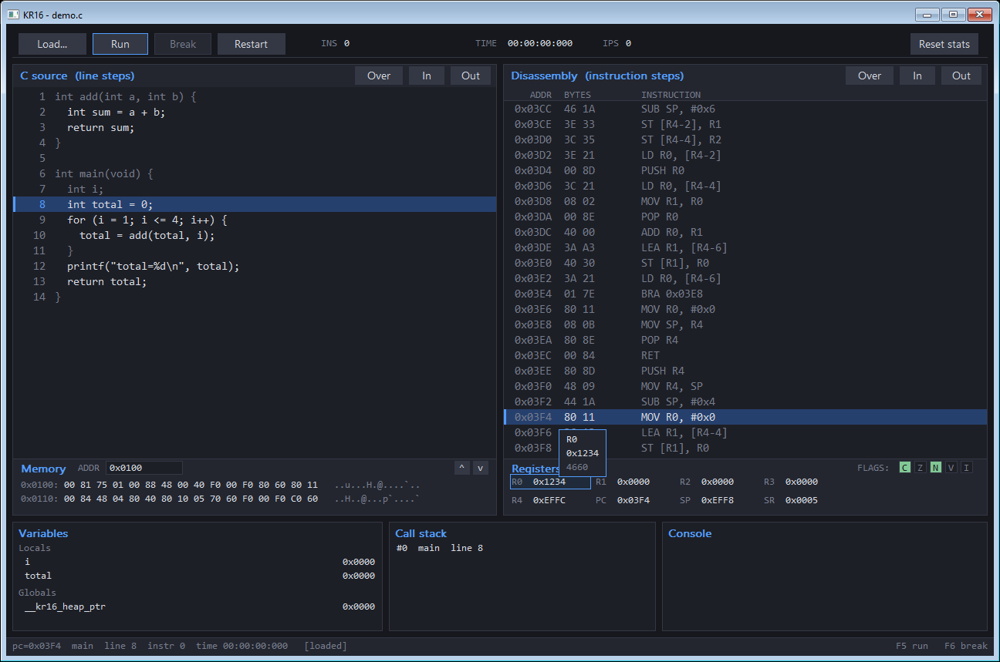

### 2026-10-28 — variable editing

- Locals and globals are hoverable (name, scope, hex and signed decimal).
- Scalar variables are editable in place; a local was changed to `0xBEEF`
  (`48879`, signed `-16657`) and read back.
- Char-sized variables accept two hex digits; int-sized rows accept four.
  Aggregates remain read-only.
- Edited rows use the shared amber-free highlight style and update immediately.

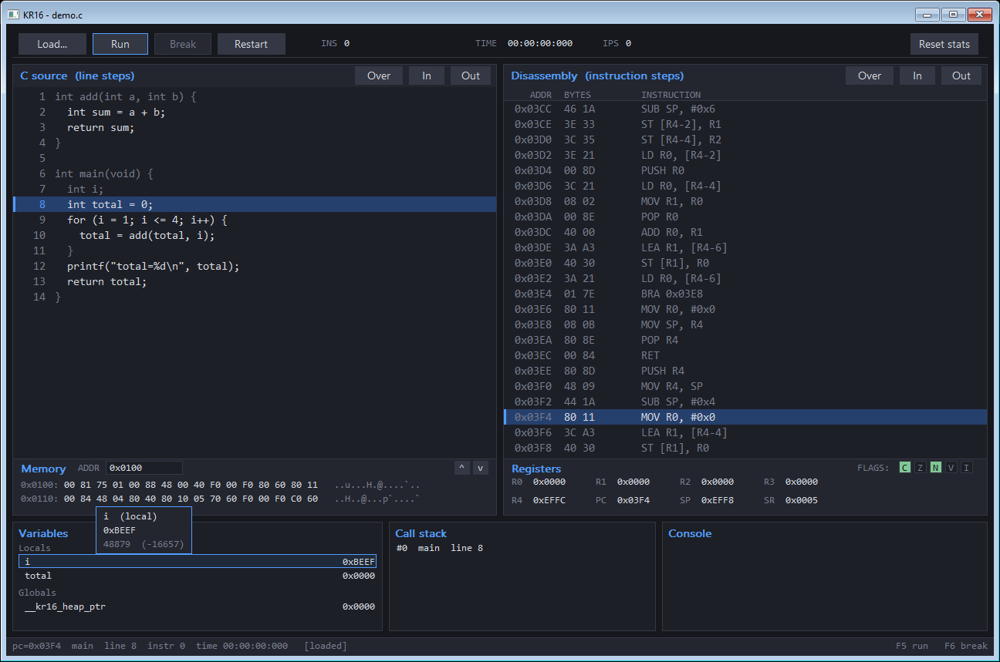

### 2026-10-28 — instruction help and Reload

- Added the instruction-use hover: mnemonic regions highlight and show the
  short description.
- Added the addressing-mode hover over the operand text (register direct,
  immediate, indirect, displacement, absolute, PC-relative).
- Both use wrapped tooltip bodies and the same visual language as the register,
  variable and memory help.
- Added the **Reload** top-bar action alongside Restart.
- The approved top bar is now: Load, Run, Break, Restart, Reload, counters and
  Reset stats.

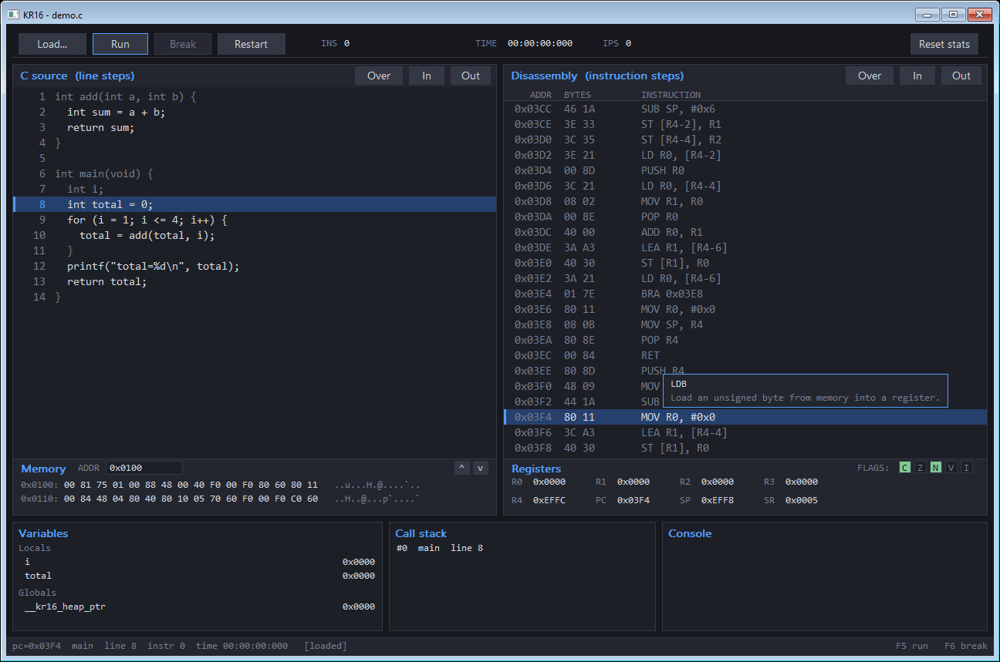

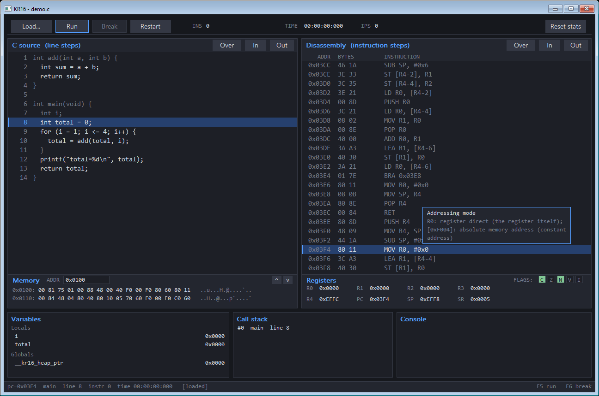

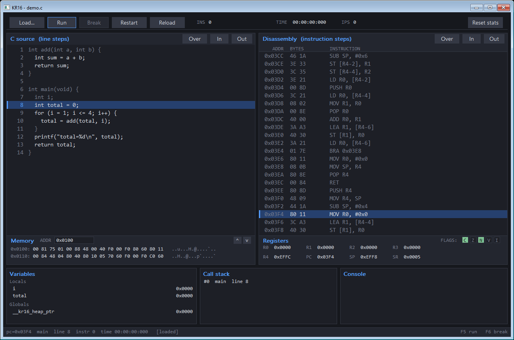

### 2026-10-28 — no-argument entry point

- `kr16` with no arguments now spawns a detached `kr16 --ui` child with
  `CREATE_NO_WINDOW`; the console parent exits immediately and the UI has no
  console.
- `kr16 --ui [file]` is the internal child entry; `kr16_ui_smoke` uses the same
  `run_ui()` path.
- `kr16 <existing .kex/.c/.s/.asm/.o>` also launches the UI with that file,
  enabling file associations and drag/drop onto the executable.
- `kr16 shell` is now an explicit command and is no longer the no-argument
  default. `usage_text()` documents both.
- On Linux (UI not built yet), no arguments print usage plus a clear error and
  exit 2; `kr16 shell` remains available.
- Verified no-argument launch on Windows: parent exit 0 in ~250 ms, UI process
  `KR16` running with no console.

Remaining: replace the reference harness, add the SDL3 Linux backend for x64
and ARM64, bundle fonts/resources, and produce Windows/AppImage release
artifacts.

### 2026-10-28 — SDL3 Linux backend

- Added the SDL3 window backend and a renderer canvas with an embedded
  stb_truetype glyph atlas.
- Ported the same `App` UI; the Linux window now has the source/disassembly
  panes, registers/flags, memory strip, variables, call stack, console and
  top-bar counters.
- Added static SDL3 via pinned `FetchContent` and `-Wno-error` handling for
  SDL's own targets.
- Verified under Xvfb:
  - C source loads and builds through the real compiler/libc pipeline;
  - Run produces live counters (13.2M instructions, 12.1M IPS);
  - Break pauses at an instruction boundary and re-enables step/Run.

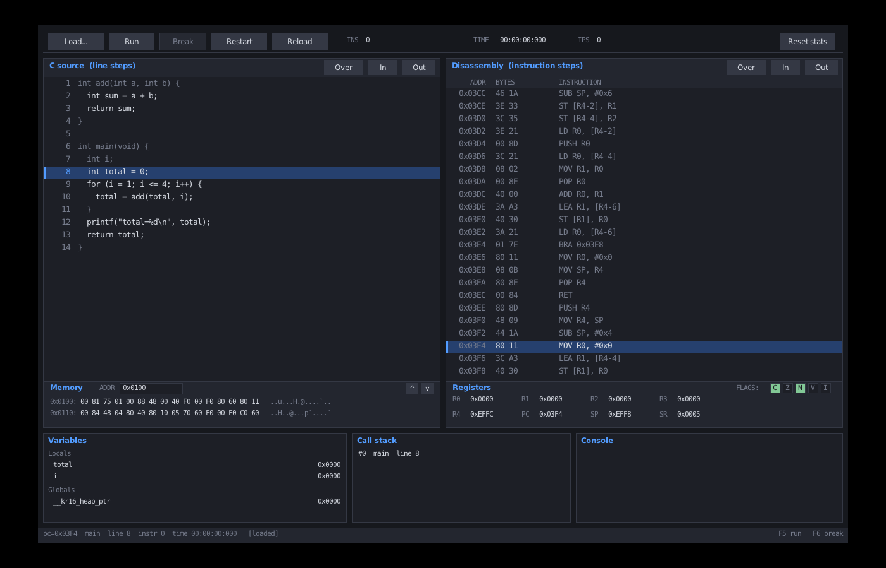

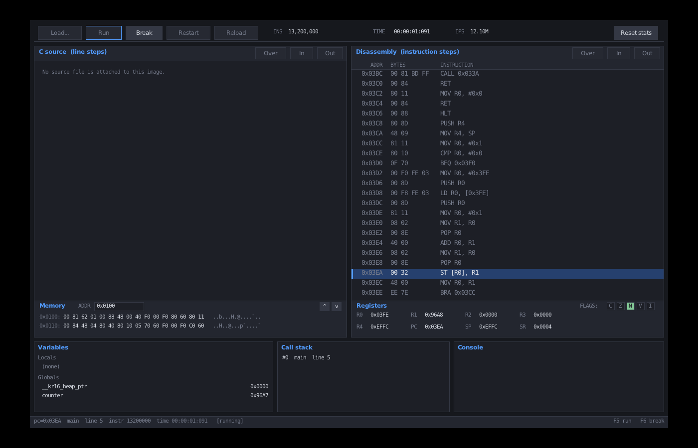


The Linux backend uses embedded, subsetted JetBrains Mono and Inter glyphs
generated by `resources/fonts/embed_fonts.py`; no font package is needed at
runtime. The remaining work is ARM64 CI and AppImage packaging.

### 2026-10-28 — embedded fonts on both backends

- Added OFL JetBrains Mono and Inter TTF files plus their license texts under
  `resources/fonts/`.
- Subsetted them to Latin-1, generated `src/resources/embedded_fonts.cpp`, and
  linked the same data into both platform backends.
- The SDL3 canvas builds its glyph atlases directly from the embedded bytes;
  the Win32 backend registers the fonts in-process with
  `AddFontMemResourceEx` and creates its GDI faces from them.
- No system font directory is required on Linux, and the Windows UI no longer
  relies on Segoe UI/Consolas for its faces.

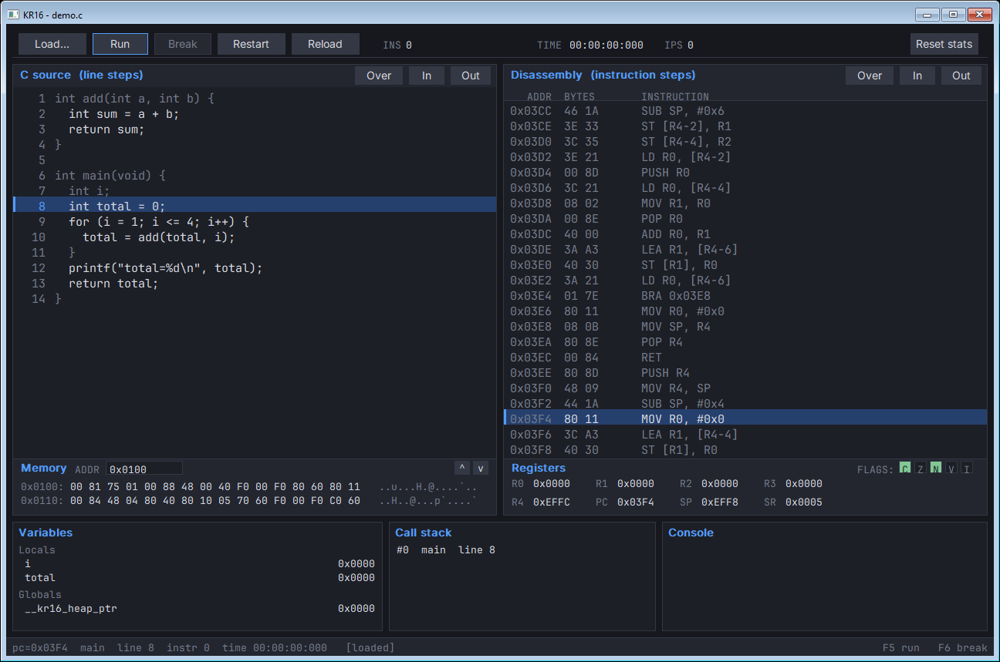

### 2026-10-28 — AppImage and single-exe checks

- Added `packaging/linux/package-appimage.sh`, desktop metadata, AppRun, icon
  and the `resources/libc.s` payload.
- Built and verified the Ubuntu 22.04 x64 AppImage (`dist/KR16-x86_64.AppImage`,
  2.8 MB). The embedded binary depends only on glibc/libm; libstdc++ is linked
  statically and SDL3 is static.
- Verified the AppImage's CLI (`--version`) and the windowed UI with the C demo
  under Xvfb; the bundled resource directory is found through
  `KR16_RESOURCE_DIR`.
- Verified the Windows `kr16.exe` with `dumpbin /dependents`: only
  `WS2_32`, `USER32`, `GDI32`, `COMDLG32` and `KERNEL32` — no MSVC runtime DLLs
  and no SDL DLL. The console parent and `--ui` child are the same single file.


### 2026-10-28 — embedded libc and truly single-file Windows

- Embedded `libc.s` as `src/resources/embedded_libc.cpp`; `find_libc_source()`
  searches files first and otherwise writes the embedded copy to the temp
  directory.
- The whole compile/assemble/link path now goes through that helper, including
  the windowed UI.
- Verified with only `kr16.exe` and `demo.c` in an empty directory: `build`
  produced `demo.kex`, and opening `demo.c` loaded it in the UI without any
  `resources/` directory.
- The AppImage still carries `resources/libc.s` for inspection, but the binary
  no longer requires it.

### 2026-10-28 — ARM64 and release automation

- Added a native `ubuntu-24.04-arm` CI job that installs the same X11/Wayland
  build dependencies, configures the UI, builds and runs the CTest suite.
- Added `.github/workflows/release.yml`: on a `v*` tag it builds/tests the
  Windows release exe, builds x64 and ARM64 AppImages, and publishes all three
  assets.
- `package-appimage.sh` selects `x86_64` or `aarch64` from `uname -m`, so the
  same script runs on either native runner.
- x64 packaging is verified locally; the ARM64 job and tag publish still need
  their first GitHub run.

### 2026-10-28 — ARM64 backend verification

- Added [linux-aarch64.cmake](../../cmake/toolchains/linux-aarch64.cmake) and
  cross-built the full UI with `aarch64-linux-gnu-g++`.
- Built static SDL3 for ARM64 with the offscreen video driver and ran the UI
  under `qemu-aarch64`: it initialized, created the renderer, loaded an image,
  and rendered this 1280×820 frame through the offscreen backend.
- `kr16 --version` also runs as an ARM64 ELF under qemu.
- Cross-built against an Ubuntu 22.04 ARM64 sysroot with GCC 11; the resulting
  binary needs at most `GLIBC_2.34`, includes X11/Wayland support, and was
  rendered through the offscreen backend under qemu.
- Also opened a real X11 window over TCP against Xvfb and captured the C demo:
  the ARM64 build's source/disassembly panes render with the embedded fonts.
- Packaged `dist/KR16-aarch64.AppImage` (2.7 MB) and ran its CLI/UI under
  qemu with the 22.04 sysroot.

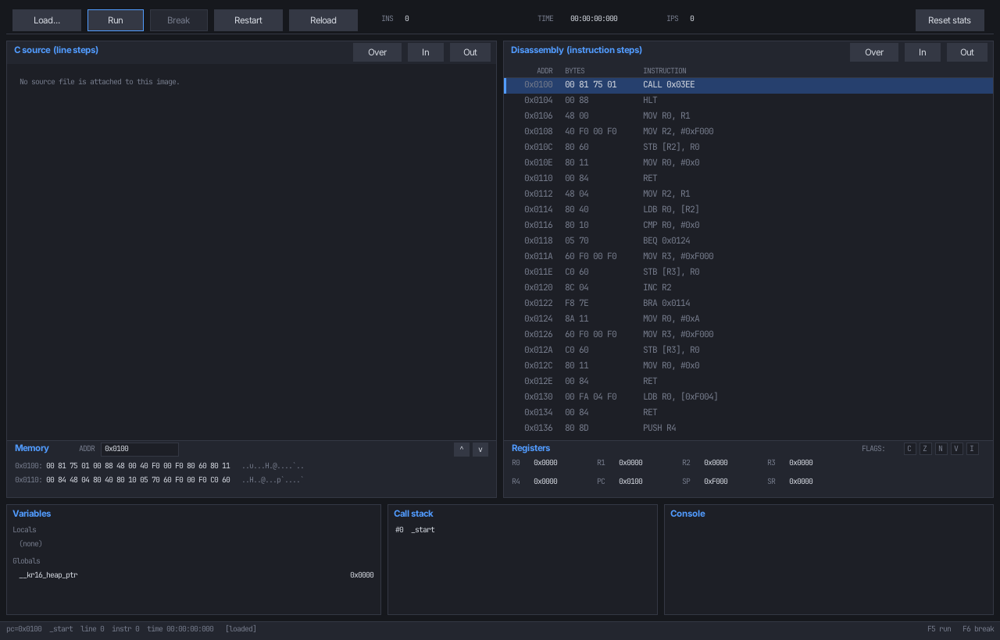

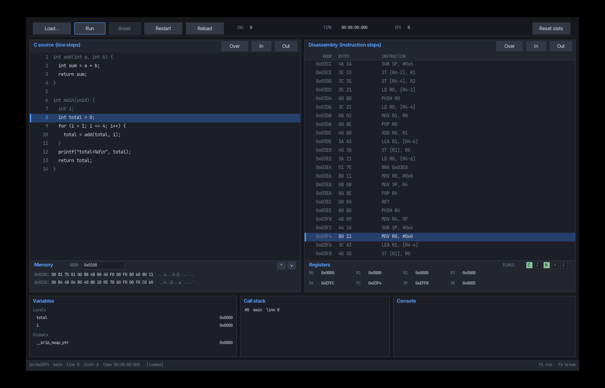


The tag workflow builds the ARM64 AppImage inside an `arm64v8/ubuntu:22.04`
container for the same baseline.

### 2026-10-28 — disassembly spacing, gutter and Step @ Reset

- Widened the instruction-bytes column so four-byte instructions keep a clear
  gap before the mnemonic (`00 81 BD FF  CALL`).
- Widened the address/breakpoint gutter and enlarged the breakpoint marker to
  a 14×14 red block; the current-PC bar stays outside it.
- Added a **Step @ Reset** checkbox to the top bar. When enabled, loading,
  restarting or reloading:
  - reads the reset vector at `$FFFE`;
  - uses that address when non-zero, otherwise `0x0100`;
  - adds a breakpoint at that address and sets PC there.
  This makes a reset vector/BIOS entry immediately steppable; the status line
  reports the vector or the no-BIOS fallback.
- Shifted the counters to make room; at narrow widths the timer and IPS fields
  are omitted rather than overlapping Reset stats.

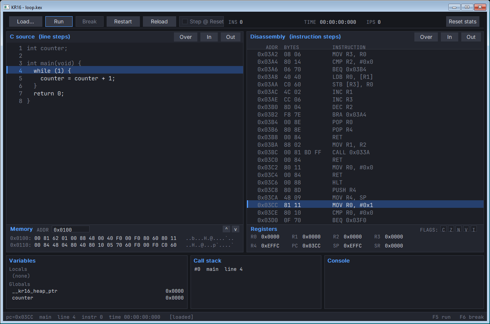

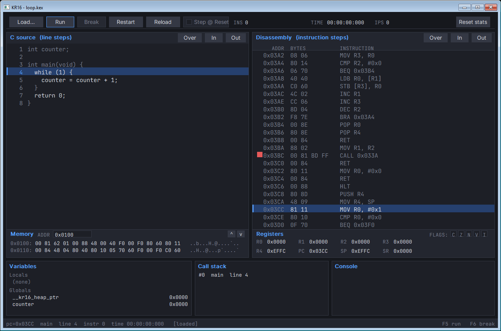

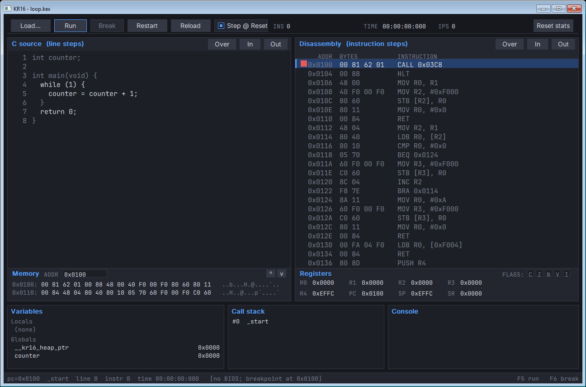
