# KR16 Visual Debugger — Feasibility and Scope

Research note. No product code was changed. All claims below were checked against
the 1.0.0 tree and a built `kr16.exe`; reproduction commands are in
[Appendix A](#appendix-a--reproduction).

> **Product status.** The windowed UI from `tools/mockup/` is now the approved
> product UI. The integration architecture, decisions and phase plan are in
> [`ui-integration-plan.md`](ui-integration-plan.md). Phase 0 has started with
> the portable `DebugSession` core and `include/kr16/ui` interfaces.

## 1. Short answer

Yes, this is feasible, and the "window owned by `kr16`" architecture is the
*simpler* one, not the harder one. But the project is not primarily a GUI
project. Two things dominate the effort:

1. **C-line stepping does not exist today.** The current adapter steps one
   *instruction* per click. That is why the VS Code experience feels like an
   assembly debugger even when you are looking at C. A prettier window on top of
   today's engine would reproduce the same confusion.
2. **The debug information is thinner than the design document claims.** It is
   good enough for scalar locals and line breakpoints, but function boundaries,
   declaration lines, multi-file line tables, aggregates and interrupt fidelity
   are all missing or broken in small, specific ways.

The good news: the hard, unglamorous parts already exist and work — a
deterministic VM, a container with symbols and sections, a line table, a
disassembler, a frame-pointer walk, a memory reader, and MMIO console I/O that a
GUI can capture without a terminal. A custom debugger can link the C++ core
directly and skip DAP, JSON, sockets and threads entirely.

Rough sizing for a single experienced developer, part-time:

| Milestone | Effort |
|---|---|
| Prove the stepping model headlessly (engine + tests) | 1–2 weeks |
| Thin GUI: C pane, asm pane, two step toolbars, locals/stack/memory/breakpoints, console | 2–4 weeks |
| Polished v1 (aggregates, multi-file, input, Linux, docs) | +3–6 weeks |

Recommended sequence: build the engine first, wire it into the existing DAP so
VS Code improves immediately, then build the window. The engine work is required
for any front end, and it is testable without a GUI.

A throwaway two-pane mockup has since been built and exercised; it validates the
interaction and found one more toolchain defect. See
[§13](#13-mockup-validation-throwaway).

The riskiest assumption is not "can we draw a window." It is "does the line
table support a good C stepping experience." It mostly does, with caveats in
[§6](#6-breakpoints-and-why-the-current-model-breaks).

## 2. What already exists

| Piece | Where | State |
|---|---|---|
| 16-bit VM, exact single-step | [`src/vm/runner.cpp`](../../src/vm/runner.cpp), [`src/cpu/cpu.cpp`](../../src/cpu/cpu.cpp) | Solid. No caches or pipelines, so single-step is exact. |
| Container with symbols, sections, relocations | [`include/kr16/container.hpp`](../../include/kr16/container.hpp) | Solid. `.kex` is self-contained. |
| Line table (`.debug_line`) | [`src/debug/debug_info.cpp`](../../src/debug/debug_info.cpp), [`include/kr16/debug_info.hpp`](../../include/kr16/debug_info.hpp) | One row per instruction while a `.loc` is active — dense enough for "line changed" stepping. |
| Disassembler | [`src/dis/disassembler.cpp`](../../src/dis/disassembler.cpp) | Symbol-aware, reusable as a library. |
| Frame-pointer call stack | [`src/dap/dap_session.cpp:1058`](../../src/dap/dap_session.cpp#L1058-L1075) | Structurally correct: `[R4]` = saved FP, `[R4+2]` = return address. |
| Memory read, register view | [`src/dap/dap_session.cpp:1197`](../../src/dap/dap_session.cpp#L1197) | Works. |
| Program console via MMIO | [`src/vm/machine.cpp`](../../src/vm/machine.cpp) | `console_output()` and `push_key()` are exactly what a GUI console pane needs. |
| Build pipeline callable in-process | [`include/kr16/build.hpp:38`](../../include/kr16/build.hpp#L38) | A "Rebuild" button can call it directly, no subprocess. |

The DAP adapter already exposes close to the primitive set a GUI needs:
`stackTrace`, `scopes`, `variables`, `readMemory`, `disassemble`, `evaluate`,
`setBreakpoints`, `continue`, `next`, `stepIn`, `stepOut`. That code is a useful
reference, but a GUI should not talk DAP to an in-process VM.

## 3. What the current debugger actually does

These are measured, not inferred. `next` was pressed eight times from `main`.

```
at main        pc=0x03ee frame=main      line=5  locals=[i=0 total=0 ...]
after next 1   pc=0x03f0 frame=<program> line=5  ...
after next 2   pc=0x03f2 frame=<program> line=5  ...
after next 3   pc=0x03f4 frame=<program> line=10 ...
```

And with a breakpoint on the first address of `add`:

```
stopped at 0x03c8 frame=add line=22
```

`0x03c8` is `add`'s prologue. Line 22 is `return total;` in `main`. The C view is
pointing at the wrong function.

### Root causes, in order of impact

1. **No line stepping.** `handle_step` maps `next`/`stepIn` to one instruction
   ([`dap_session.cpp:1404`](../../src/dap/dap_session.cpp#L1404-L1426)).
   `next` only special-cases `CALL`; `stepIn` is literally one instruction
   ([`run_single_instruction`](../../src/dap/dap_session.cpp#L682)).
2. **Function symbols have no `.type`/`.size`.** The compiler emits `.global`
   but never `.type function` / `.size`, although the assembler supports both
   ([`assembler.cpp:1455`](../../src/asm/assembler.cpp#L1455-L1466)). So
   `function_name()` only matches an exact address
   ([`dap_session.cpp:219`](../../src/dap/dap_session.cpp#L219-L242)), and every
   frame except the entry instruction becomes `<program>`.
3. **Line lookup crosses function boundaries.** `line_for_address()` returns the
   nearest preceding row with no clamping
   ([`dap_session.cpp:244`](../../src/dap/dap_session.cpp#L244-L262)). Because
   the compiler emits no `.loc` before a function prologue, the prologue
   inherits the previous function's last line. That is the `add` → line 22 hit.
4. **Declaration-only lines never map.** `int i;` compiles to no instruction, so
   line 9 of the demo has no row. The adapter reports such breakpoints
   unverified (`"no debug line row maps to this line"`). Students click a line and
   get a hollow circle for no visible reason.
5. **A loop line maps to one address only.** `address_for_line()` returns the
   *first* row for a line ([`dap_session.cpp:264`](../../src/dap/dap_session.cpp#L264-L275)).
   A `for` header appears at several address ranges; a breakpoint on it fires
   once, not every iteration.
6. **`stepOut` peeks `[SP]`.** It assumes the top of stack is the return address
   ([`run_out`](../../src/dap/dap_session.cpp#L729-L744)). Inside a function
   with pushes or locals, `[SP]` is a temporary, so step-out can target garbage.
   The correct source is `[R4+2]`.
7. **Only the first `.debug_line` section is read.** The linker emits one
   `.debug_line` output section per input object
   ([`linker.cpp:104`](../../src/link/linker.cpp#L104-L114)), but the debugger
   uses `find_section(".debug_line")`, which returns the first
   ([`container.cpp:470`](../../src/container/container.cpp#L470-L476)). With two
   debug-enabled objects, breakpoints in the second file are unverified:
   ```
   app.c line 4 verified:    {"verified":false,...}
   helper.c line 2 verified: {"id":1,"verified":true,...}
   ```
8. **`.crt0` line rows are mislocated.** The linker adjusts every row by the
   object's `.text` placement ([`linker.cpp:255`](../../src/link/linker.cpp#L255-L283)),
   but `_start` lives in `.crt0`. Its two rows land on `add`'s first two
   addresses and say "line 22". This is the direct cause of the `0x03c8` result.
9. **Locals are flat and untyped.** `.debug_vars` is text
   `function|name|offset|size` ([`compiler.cpp:1762`](../../src/cc/compiler.cpp#L1762-L1785));
   `.debug_types` is only `name|size`. Every local is rendered as one 16-bit
   word. There is no way to expand `values[0..3]` or `p.x`/`p.y`; the probe shows
   `values=0x0000` and `p=0x0000` because only the first word is read.
10. **The debug runtime is not faithful to `kr16 vm`.** The DAP loader never
    writes `argc`/`argv` onto the stack, never installs the interrupt
    acknowledge, and never feeds keyboard input
    ([`load_program`](../../src/dap/dap_session.cpp#L514-L576)). `run_vm` does
    all three ([`runner.cpp:86`](../../src/vm/runner.cpp#L86-L131),
    [`runner.cpp:170`](../../src/vm/runner.cpp#L170)). Programs using
    `main(argc, argv)`, timers or `getchar()` behave differently under the
    debugger than under `kr16 vm`.
11. **Windows source paths are escape-mangled.** The compiler writes a raw path
    into `.file` (for example `C:\Users\...\build\mock\demo.c`) and the
    assembler's string unquoting interprets `\r`, `\n` and `\t`
    ([`assembler.cpp:668`](../../src/asm/assembler.cpp#L668-L693)). The `\repos`
    segment becomes a carriage return, so `.debug_sources` contains a path that
    cannot be opened. The mockup hit this immediately; the fix is to emit
    escaped backslashes or forward slashes in `.file`, or to stop
    escape-processing `.file` paths. This also affects VS Code source
    breakpoints on any path containing those sequences.

### Why VS Code cannot express the requested interaction

VS Code's debug UI has exactly one step toolbar, bound to one session. It cannot
show a second, independently-clickable set of step controls beside a
disassembly. The current extension works around this with a read-only `asm`
document that is rewritten on every stop
([`vscode/extension.js`](../../vscode/extension.js)), which is a snapshot view,
not a control surface. That limitation is structural, not a missing extension
feature. The two-toolbar design essentially requires a custom UI.

### What this means

The VS Code complaint has two layers. The extension is heavy, yes, but a large
part of the friction is the adapter being a thin, instruction-granular,
partially-faithful backend. A custom window is necessary but not sufficient. Fix
the engine first; the GUI then becomes mostly rendering.

## 4. The model: one PC, two granularities

The clean mental model is:

- **Truth** is `(machine, cpu, pc)`. One execution state.
- **Assembly pane** is a view at instruction granularity.
- **C pane** is a view at statement granularity, derived from the line table.
- Both toolbars issue commands to the same executor. They are "linked" because
  they read the same PC, not because they synchronize two VMs.

Two cursors, one position:

- The *instruction cursor* is exact: the PC.
- The *statement cursor* is derived: the line whose row range contains the PC,
  clamped to the enclosing function.
- Stepping in either pane moves the PC. The other pane re-renders from the same
  snapshot.

This is why the two toolbars do not need independent execution state, and why
"step C" and "step asm" cannot drift apart.

### State snapshot

After every stop, produce one snapshot and render everything from it:

```
Snapshot {
  pc, sp, sr, flags, cycles, instructions
  frames[]: { index, function, line, fp, return_address }
  locals (for selected frame), globals
  current_line, current_statement_range (first_addr, last_addr)
  disassembly window around pc
  console_delta
}
```

No view should own state. That keeps the six panes consistent and makes
"frame selection" (clicking a stack frame to inspect its locals) easy to add.

## 5. Stepping semantics

### Modes

| Mode | Pane | Meaning |
|---|---|---|
| `Instruction` | asm | Execute exactly one instruction. |
| `InstructionOver` | asm | One instruction; if it is a call, run to the return address. |
| `InstructionOut` | asm | Run until the current function returns (`[R4+2]`). |
| `LineIn` | C | Run until the source line changes (enter calls). |
| `LineOver` | C | Run until the line changes at the *same or shallower* frame depth. |
| `LineOut` | C | Run until the line changes at a *shallower* frame depth. |
| `Continue` | both | Run until a breakpoint, halt, fault or budget. |

`LineIn/Over/Out` are the same primitive with different predicates. That is the
whole trick.

### Core algorithm

```text
run_until(stop_predicate, budget):
    repeat:
        if halted: return Halted
        if budget exhausted: return Budget
        before = current_line(pc, frame_depth)
        execute one instruction
        after  = current_line(pc, frame_depth)
        if stop_predicate(before, after, frame_depth):
            return Step
    # breakpoints are checked against `after` as well
```

`current_line(pc)` must:

1. find the enclosing function by symbol range (requires `.type`/`.size`, or at
   least an ordered function-symbol table),
2. search only that function's rows,
3. if `pc` precedes the function's first row, return that first row's line
   (entry line), never the previous function's last line.

Predicates:

```text
LineIn:   after != before
LineOver: after != before and depth_after <= depth_at_start
LineOut:  after != before and depth_after <  depth_at_start
```

Frame depth is the number of frames in the FP walk. It grows on `CALL` inside a
callee and shrinks on `RET`. Comparing depth, rather than return addresses,
handles recursion correctly.

### Why "line changed" and not "next row address"

"Run to the next statement's start address" is wrong for branches, loops,
`while` conditions, `goto` and `switch`. Checking the line after every
instruction handles all of them, and it is cheap: the VM executes millions of
instructions per second and a step is a handful of instructions.

### Edge cases to decide explicitly

| Case | Suggested policy |
|---|---|
| Statement compiles to many instructions | Line changes only at statement boundaries, so one C step is one statement. Show "instruction 3 of 7" in the status bar. |
| Two statements on one source line (`a(); b();`) | There is no column information (`.loc` always emits column 0), so the line cannot change between them. Both execute in one C step. Acceptable, but document it. |
| `for` header | Condition and increment share the `for` line, so stepping the body bounces 15 → 16 → 15. That is correct and instructive. |
| Function with no line rows (libc, `_start`, BIOS) | C pane shows "(no C source)". C step keeps running until line info returns, with a budget. |
| Interrupt handler | KR16 delivers IRQs; the handler has no C rows. Either run through it transparently or stop with reason "interrupt". Do not let a C step land in a handler and look frozen. |
| `BRK` / faults | Stop with a specific reason and highlight the instruction. The VM already halts with a reason ([`cpu.hpp`](../../include/kr16/cpu.hpp)). |
| `SYSCALL` / MMIO | Single instruction; no special handling. Console output drains after each stop. |
| Blocking `getchar` | libc busy-waits on MMIO. If PC stays in a tiny range with an empty keyboard queue, pause with "waiting for keyboard input". This is a teaching feature, not a bug. |
| Step budget | A line step that never changes line (e.g. a tight infinite loop on one line) must stop at, say, 1,000,000 instructions with reason "budget". The DAP already has this guard. |

## 6. Breakpoints, and why the current model breaks

A source-line breakpoint is not an address. It is a `(file, line)` predicate.
Checking it at instruction boundaries, when the line changes, gives:

- every address range of a loop line, not just the first;
- correct behaviour when a line has no code (snap to the next executable line);
- hit counts and conditions later, for free;
- a clean list to show in a Breakpoints window.

Address breakpoints (asm pane gutter) remain direct address checks.

Suggested rules:

- C gutter click: resolve line → nearest executable line. If the click is on a
  blank/comment/declaration line, snap forward and say so in the UI ("line 9 has
  no code; breakpoint moved to line 10"). Non-executable lines can be dimmed in
  the gutter, which is itself a good teaching aid.
- Asm gutter click: address breakpoint, exact.
- Breakpoints window shows both kinds, with source location or address, enable
  checkbox and hit count.

## 7. The six panes

Layout that fits 1366×768 classroom laptops:

```
+-------------------------------------------------------------------+
| [Open] [Rebuild] [Restart] [Run/Pause]     sum.c — main() line 12  |
+---------------------------------+---------------------------------+
| C source                        | Disassembly                     |
| [Step] [Over] [In] [Out]        | [Step] [Over] [In] [Out]        |
|   1  int sum_to(int n) {        | 0x0412  MOV R1, R0              |
|   2    int i;                   | 0x0414  ...                     |
| > 3    int total = 0;           | >0x0418 CMP R0, R1              |
|   4    for (...)                | 0x041A  BLT .Lcmpyes            |
+---------------------------------+---------------------------------+
| Variables        | Call stack       | Memory        | Breakpoints   |
| total = 0        | main()  line 12  | 0x0FF0 00 00  | sum.c:3       |
| i     = 0        | sum_to() line 3  | 0x0FF2 0A 00  | 0x0418        |
+-------------------------------------------------------------------+
| Console: 5 10 15 ...                                              |
+-------------------------------------------------------------------+
```

Design notes that matter for a beginner:

- **Label the toolbars by granularity**, not just icons: "Step C line" vs
  "Step instruction". Two identical play/arrow clusters are the main confusion
  risk.
- **Show the linkage.** When stopped in C, bracket the instruction range of the
  current statement in the asm pane. When stopped in asm mid-statement, dim the
  C line and show "in the middle of line 12".
- **Highlight changed values.** Locals that changed since the last step should
  flash or use a different colour. This is the single most useful teaching
  affordance in a debugger.
- **Dim non-executable lines** in the C gutter.
- **Status bar**: function, line, instruction offset within the statement,
  instruction count, cycles.
- **Keyboard shortcuts**: F5 run, F10 step over, F11 step in, Shift+F11 step out,
  and a modifier for the other granularity. Students may know these from other
  tools; label them in the tooltips.
- **Console is inside the app.** This removes the VS Code "program output is in
  another terminal" complaint entirely.

## 8. In-process architecture

**Yes, `kr16` can own the window and the VM in one process.** The window owns a
`DebugSession` object that owns `Machine`, `Cpu`, `Container`, `HostServices` and
the line/function indices. "Communicating with the VM" is then an ordinary C++
method call — no protocol, no serialization, no socket, no second process.

Why this is simpler than DAP:

- No JSON, no framing, no socket, no serialization of every value.
- No thread or command queue is required. Stepping is synchronous and
  sub-millisecond.
- `Continue` can run in time-sliced chunks from the UI event loop (e.g. 5–8 ms
  per frame) and return to the message loop between slices. The UI stays
  responsive without a worker thread.
- Console output is `machine.console_output()` drained into a text widget;
  keyboard input is `machine.push_key()` from a text field. No terminal, no raw
  mode, no platform console code.
- The debugger can share the *exact* loader and runtime setup with `run_vm`,
  which fixes the fidelity gaps in §3.10. "Debug behaves like run" is a hard
  requirement for a teaching tool.

Suggested shape:

```cpp
// include/kr16/debug_session.hpp
struct Stop {
    enum class Kind { Step, Breakpoint, Halted, Fault, Budget, Input } kind;
    int breakpoint_id = -1;
    std::string message;
};

enum class StepMode { Instruction, InstructionOver, InstructionOut,
                      LineIn, LineOver, LineOut };

class DebugSession {
public:
    LoadResult load(const std::string& image, const LoadOptions&);
    Stop run(StepMode mode);          // one user click; returns quickly
    Stop run_continue();              // run to breakpoint / halt (may be long)
    Stop run_slice(int microseconds); // UI timer: bounded slice while running
    Snapshot snapshot() const;        // everything the UI draws
    void set_line_breakpoints(const std::string& file,
                              const std::vector<int>& lines);
    void set_address_breakpoints(const std::vector<std::uint16_t>&);
    std::vector<Instruction> disassemble(std::uint16_t addr, int count) const;
    std::vector<std::uint8_t> read_memory(std::uint16_t addr, int count) const;
};
```

Refactor `DapSession::Impl` to use this class. That is the highest-leverage
change in the repository: today the DAP contains the only implementation of line
lookup, frame walking, breakpoints and memory reads. A second front end should
not copy it. It also keeps DAP working for anyone who wants VS Code.

Platform note: the platform-boundary test forbids OS headers outside
`src/platform` ([`cmake/CheckPlatformBoundary.cmake`](../../cmake/CheckPlatformBoundary.cmake)).
Window creation belongs in `src/platform/window_*.cpp` behind a small portable
interface; the rest of the UI stays portable. The vendored GUI library belongs
under `third_party/`, which the test does not scan.

Packaging note: on Windows, `kr16` is a console-subsystem program. A GUI mode
that opens a window from it will also show a console window unless it is a
separate `/SUBSYSTEM:WINDOWS` target. The clean shape is two executables sharing
`kr16_core`: the existing console `kr16` and a `kr16-gui` (or `kr16 ide` wrapper
that launches the GUI executable). Keep the CLI buildable and testable exactly as
it is today.

## 9. UI technology

| Option | Owned window | Runtime deps | Cross-platform | Effort for 6 panes | Look |
|---|---|---|---|---|---|
| Win32 + Direct2D/DirectWrite (custom) | Yes | None | No (needs X11 backend) | High | Whatever you draw |
| Dear ImGui + Win32/DX11 | Yes | None (vendored, static) | Yes (backends) | Medium | Developer-tool |
| Qt 6 Widgets | Yes | Large DLL set | Yes | Low–medium | Native |
| HTML UI in a WebView (webview/WebView2) | Yes | WebView2 / WebKitGTK | Yes | Low | Very good |
| HTML UI in default browser (kr16 serves HTTP) | No (tab) | None | Yes | Low | Very good |
| Electron | Yes | Ships Chromium | Yes | Low | Very good |
| Tauri (system webview) | Yes | WebView2 / WebKitGTK | Yes | Low | Very good |

**My recommendation: Dear ImGui, vendored, Windows-first.**

- It keeps the single-binary, no-runtime-dependency property that the rest of
  the project values. `/MT` is already set, so the result is one `.exe`.
- Six debugger panes are ImGui's sweet spot: tables, child windows, scrolling,
  splitters and input come for free. The source/asm panes are read-only text
  with per-line coloured runs and a clickable gutter — a few hundred lines each.
- Cross-platform later via GLFW/OpenGL or SDL, without rewriting the UI.
- Cost: roughly 40–60k lines of vendored MIT code (about a dozen files: core,
  tables/widgets, and two backends) plus a D3D11 context. Load a real monospace
  TTF (Cascadia/Consolas) rather than the default font.
- It looks like a developer tool. For teaching assembly, that is arguably
  appropriate; it can be themed with larger fonts and friendly colours.

**Alternative if student-friendly looks matter more than a single binary:
`webview/webview`.** It gives an owned window with an HTML/CSS UI and direct
C++↔JS bindings, in-process, no sockets. The UI is far easier to make attractive
and far faster to iterate. The cost is a runtime dependency (WebView2 on
Windows, WebKitGTK on Linux), which is a deployment risk on locked-down school
images.

**Do not use:** Qt (packaging turns one exe into a folder of DLLs), Electron
(ships a browser), raw Win32 custom drawing (the effort goes into text layout
instead of the debugger), or a VS Code webview (retains the thing you are trying
to escape).

A useful de-risking trick: mock the interaction in a throwaway HTML page first
(two panes, two toolbars, fake state). It costs a day and tells you whether the
dual-toolbar idea reads clearly before you commit to a toolkit.

## 10. Scope and plan

### Phase 0 — Headless engine (1–2 weeks)

- Extract `DebugSession` from `DapSession::Impl`.
- Build indices: address→row, line→addresses, function ranges.
- Implement `Instruction`, `LineIn`, `LineOver`, `LineOut`, `Continue`.
- Logical line breakpoints and address breakpoints.
- Tests that assert exact line sequences for: straight-line code, `if/else`,
  `while`, `for`, `switch`, recursion, a call to libc, `goto`.
- Fix the debug-info defects that block correct line mapping:
  - emit `.type function` / `.size` in the compiler (small, high leverage);
  - emit `.loc` at function entry so prologues do not inherit the previous line;
  - merge or correctly relocate `.debug_line` across objects, and stop
    relocating `.crt0` rows by `.text`;
  - load *all* `.debug_line` sections, honour `row.file`;
  - escape or normalize source paths in `.file` / `.debug_sources` so Windows
    paths containing `\r`, `\n` or `\t` survive.
- Snap line breakpoints requested on non-executable lines to the next executable
  line, and report the move.
- Add a `kr16 debug --trace-steps` style transcript (line, pc, frame) so the
  semantics can be reviewed and tested without any GUI.

This phase is independently valuable: with it, the existing VS Code adapter can
be fixed to do real line stepping, so students get a better experience while the
custom UI is built.

### Phase 1 — Thin GUI (2–4 weeks)

- Window, layout, fonts, DPI, keyboard shortcuts.
- C pane: read-only, line numbers, current-line highlight, gutter breakpoints,
  dim non-executable lines, auto-scroll.
- Asm pane: address, bytes, mnemonic, PC marker, its own step toolbar.
- Variables (locals/globals, scalars), call stack, memory hex, breakpoints.
- Console pane (output + input).
- Open / Rebuild / Restart / Run / Pause.
- Single-file programs only.

### Phase 2 — Polished v1 (3–6 weeks)

- Typed variables: arrays, structs, pointers, `char` strings. This requires
  extending `.debug_types`/`.debug_vars` (kind, element type, member offsets)
  and the compiler emission. The compiler's `Type` model already has everything
  needed ([`compiler.cpp:31`](../../src/cc/compiler.cpp#L31-L73)).
- Multi-file programs: tabs, file-aware breakpoints, source paths.
- Frame selection in the call stack.
- Changed-value highlighting, watch expressions (optional).
- Interrupt-aware stepping.
- Linux backend, packaging, docs, a classroom quick-start card.

### Deliberate non-goals for v1

- Source editing (keep the app a debugger; students edit elsewhere and press
  Rebuild). If the app must replace VS Code entirely, an editor is a separate
  project.
- Conditional breakpoints, hit counts, reverse execution.
- Multi-threading (the VM has one CPU).
- A project system or file tree.
- Debugging stripped images beyond registers/memory/disassembly.

## 11. Risks

| Risk | Why it matters | Mitigation |
|---|---|---|
| Line pacing feels wrong | If one C step sometimes executes 2 statements, students lose trust | Build the headless transcript tests first; assert exact sequences |
| Debug info defects surface as UI bugs | Wrong line, missing locals, `<program>` frames | Fix at the source (compiler/linker), not in the view |
| Dual toolbars confuse | Two step clusters on one screen | Label by granularity; show statement/instruction linkage; keyboard shortcuts |
| UI polish is open-ended | It can consume the whole budget | Hard feature freeze; timebox the chrome; ship the thin GUI |
| Text rendering in ImGui | Small fonts, aliasing | Bundle/load a real TTF; support a font-size control |
| Blocking input / interrupts | A C step can appear to hang | Budget + "waiting for input" / "in interrupt" reasons |
| WebView2 availability | Locked-down school images | Prefer ImGui; if using webview, fall back to browser |
| Two front ends drift | DAP and GUI diverge | One `DebugSession`, two adapters |

## 12. Decisions needed

1. **Platform:** Windows classroom only, or Windows + Linux? Windows-only halves
   the GUI work.
2. **Window vs browser:** owned native window (ImGui) or HTML UI (webview or
   browser tab)? This is the main technology fork.
3. **Debugger or IDE:** can students keep editing in another program, with a
   Rebuild button? If `kr16` must be the whole environment, add an editor phase.
4. **Fidelity for v1:** are scalar locals, arrays-as-bytes and single-file
   programs acceptable, or must arrays/structs expand from day one?
5. **DAP future:** keep VS Code working as a second front end, or retire it?

## 13. Mockup validation (throwaway)

A two-pane mockup was built to test the interaction before committing to a GUI
toolkit. It lives in [`tools/mockup/`](../../tools/mockup/README.md), links the
existing `kr16_core.lib`, and is a single statically linked `.exe` with no
runtime installs. It executes a real `.kex`; it is not a static fake. No existing
source file was changed.

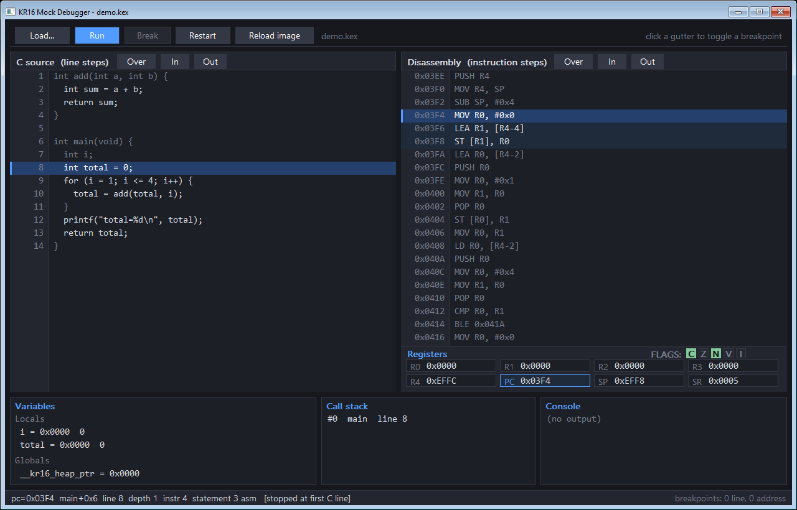

The C pane has its own line-step buttons and the disassembly pane has its own
instruction-step buttons. Stepping in either updates both, plus the variables,
call stack, console and status bar. The current statement's instruction range is
shaded in the disassembly, with the exact PC in a stronger colour. Non-executable
lines are dimmed.

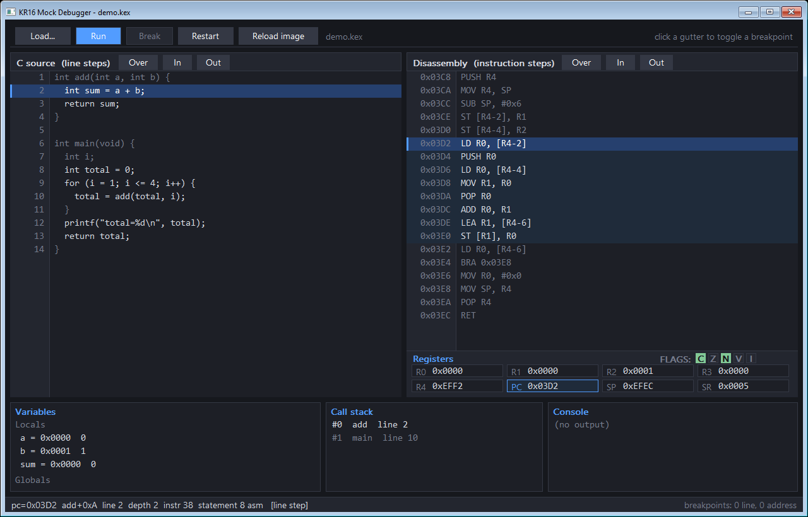

After `step in` at the call, the C pane is on `add`'s first statement, the
disassembly pane has switched to `add`, and the call stack has two frames. The
locals are `add`'s parameters and local.

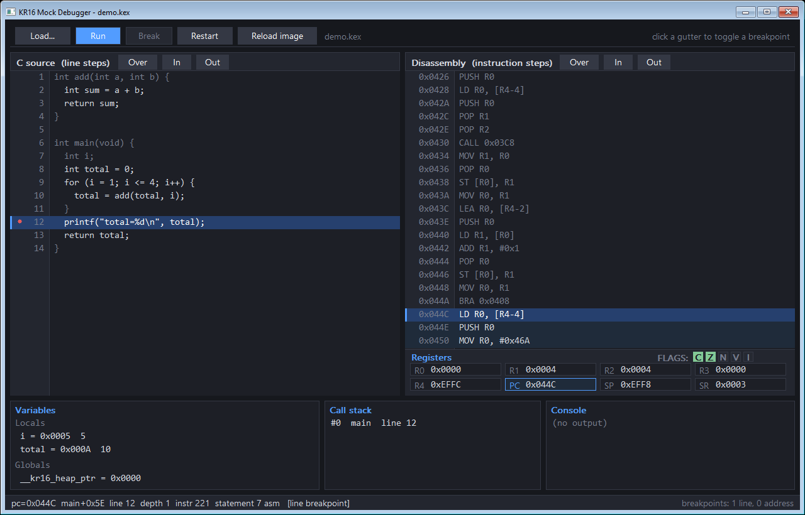

A line breakpoint set through the C gutter, then Run: the loop has completed,
`i` and `total` have their final values, and the console is still empty because
`printf` has not run yet. A second Run executes it and shows `total=10`.

The disassembly pane also carries a compact register strip: R0–R4, PC, SP and SR
in hex. The C/Z/N/V/I flag bits are boxes under a `FLAGS:` label that turn green
when set. Hovering a register shows its hex and decimal value; hovering a flag
shows its name and state. Registers are click-to-edit (hex only) and flags are
click-to-toggle.

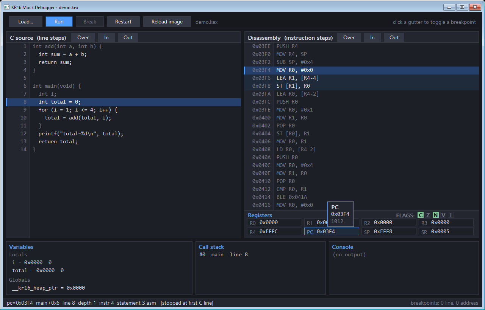

The top bar is **Load… / Run / Break / Restart / Reload image**. Load accepts a
`.kex` directly, or compiles/assembles/links a `.c`, `.s`, `.asm` or `.o` with
the same pipeline as `kr16 build`. C input always links libc, and the mockup
embeds `libc.s` so a C file can be loaded without a `resources` folder beside
the executable. Run executes in 8 ms slices so the window stays responsive;
Break stops at the current instruction boundary. That is the interaction a
product window would need.

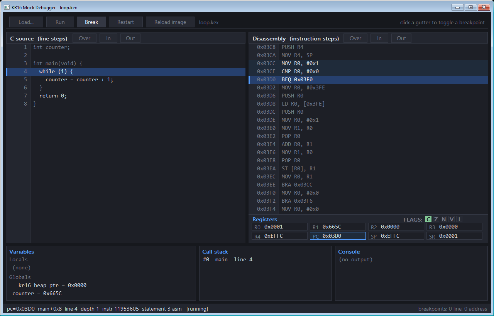

The disassembly now has `ADDR`, `BYTES` and `INSTRUCTION` columns. `BYTES` is a
fixed-width field showing the 2- or 4-byte memory-order encoding, so 32-bit
instructions do not push the mnemonic column out of alignment.

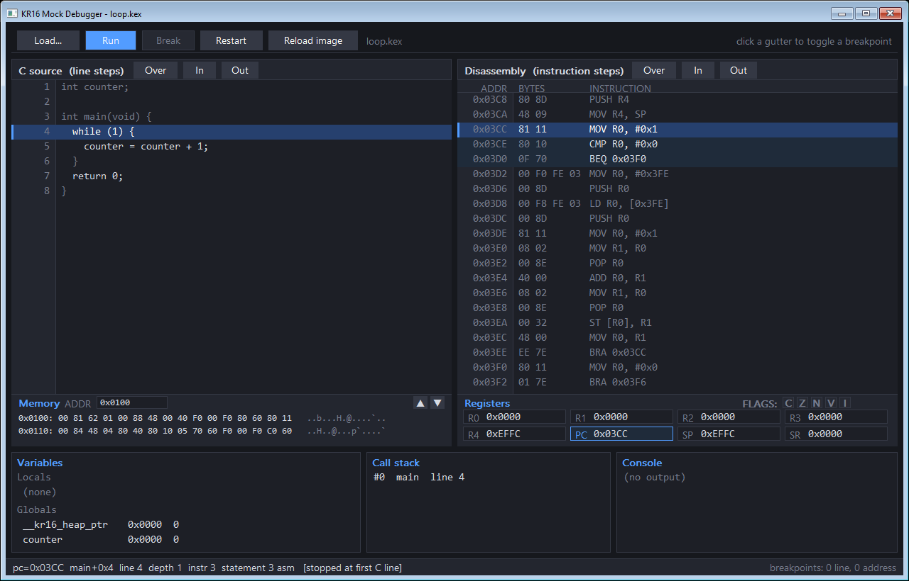

Hovering a mnemonic shows a short description of the instruction; hovering the
operand text explains each operand's addressing mode. Both use the same tooltip
box as the register and variable help, with wrapped body text.

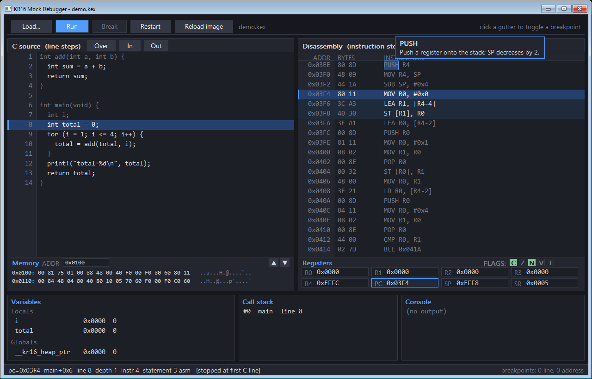

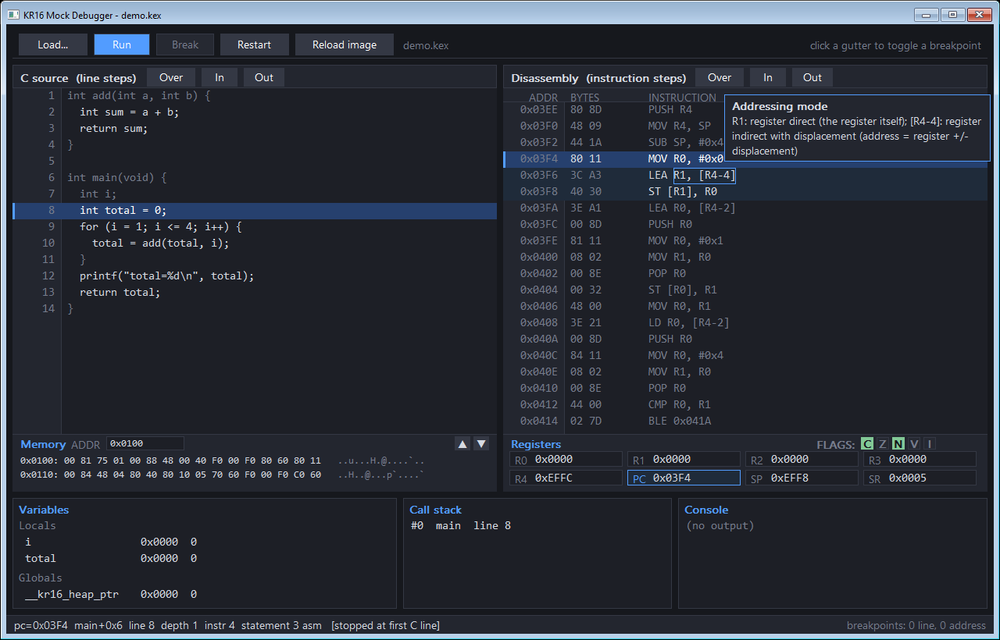

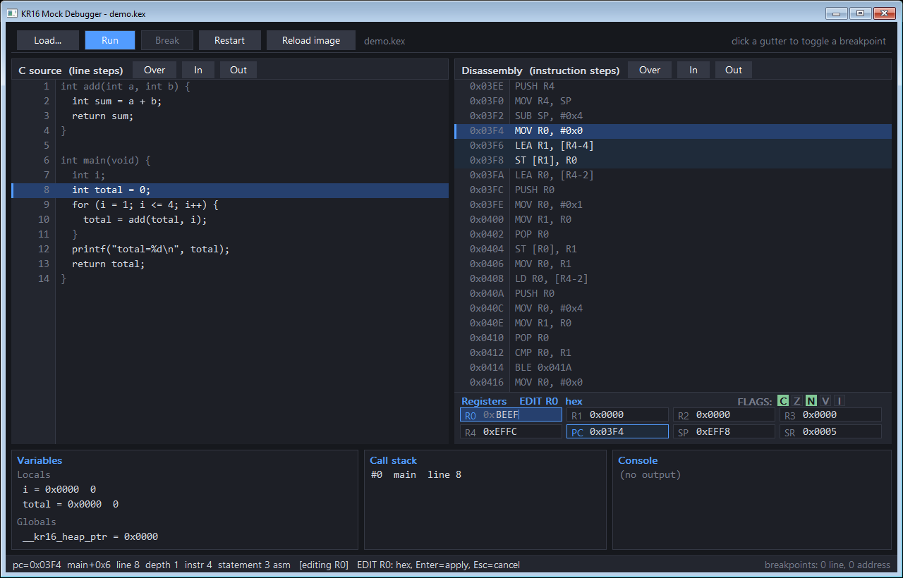

### Editing registers

Technically this is easy. `Cpu` already exposes `set_reg`, `set_pc`, `set_sp`,
`set_sr` and `set_flag`
([`cpu.hpp`](../../include/kr16/cpu.hpp)), and the debugger is paused at
instruction boundaries, so an edit can be applied and the snapshot rebuilt. No
debug-info or VM change is needed. "Can we" is not the problem; deciding
"should we, and where" is.

Recommendation:

- **v1: read-only, with changed-value highlighting.** Flash or colour registers
  that changed since the previous stop. This delivers most of the teaching value
  (watching R1/R2 carry arguments, SP move on a call, flags change after CMP)
  with no risk of corrupting the machine.
- **v2: opt-in editing.** Double-click a cell (or an Edit toggle) to enter a
  value. Start with R0–R4 and individual flag toggles, which are safe and
  instructive. Allow PC with a confirmation, because it moves the source line
  and the stack context. Treat SP and R4 (the frame pointer) as advanced or
  disallow them: changing them can invalidate the frame chain, so the call stack
  and locals may become meaningless.
- **Pause only.** Apply edits at the current instruction boundary, never while
  running.
- **Validate and be explicit.** Accept `0x1234` and `1234` with a visible base,
  clamp to 0–65535, and show the parsed value before applying. Mark the session
  as modified and make Restart the escape hatch; a full undo stack is not needed
  for a teaching tool.
- **Prefer flag toggles over raw SR editing.** Clicking C or Z is more
  instructive than typing a new SR word, and it keeps the other bits intact.
- **Degrade gracefully.** After a PC edit the current line may have no source;
  after an FP/SP edit the stack may be invalid. Show "(no source)" or "stack
  unavailable" instead of guessing.

The mockup now implements the opt-in version: click a cell, type 1–4 hex digits,
`Enter` applies and `Esc` cancels; flags are click-to-toggle; edited cells get an
amber outline and the strip shows `Registers *`. The product recommendations
above still apply, especially for PC/SP/FP guards and changed-value
highlighting.

Variables use the same pattern: hover a local or global row for its name, scope,
hex value and decimal value; click a scalar row to edit it in hex. Locals are
written at `[R4-offset]`, globals at their symbol address. Arrays and structs
show `[N bytes]` and stay read-only until the debug data carries element and
member types.

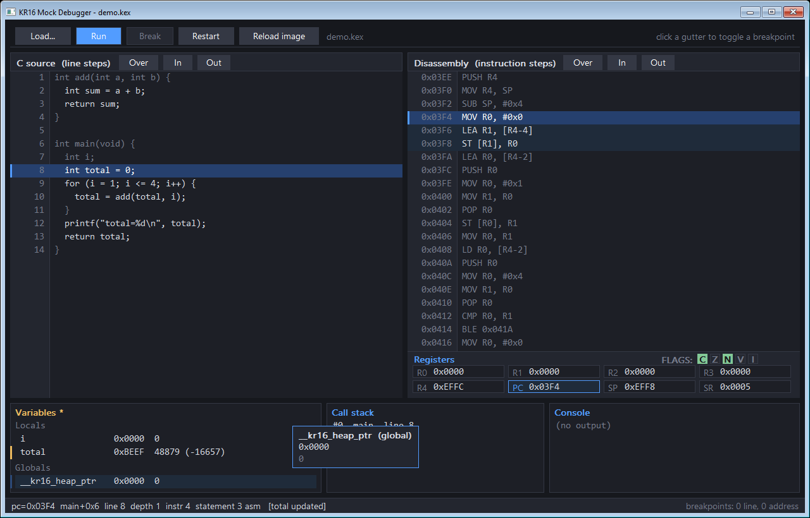

The C pane's memory strip mirrors the register strip: two rows of 16 bytes with
an ASCII column, an editable hex start address, wheel/arrow scrolling, and
per-byte hover and editing. Both strips share a top edge across the split. A
byte edit writes live memory, so editing a code byte changes what will execute.

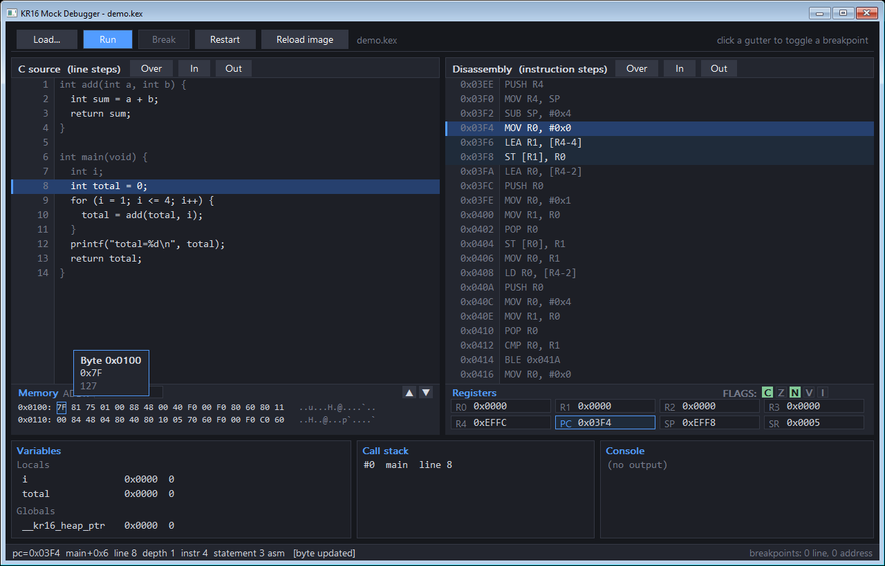

### What this validated

- **The dual-toolbar idea reads clearly.** The pane titles ("C source (line
  steps)" and "Disassembly (instruction steps)") plus the distinct button groups
  are enough to tell them apart; no extra legend was needed in the mockup.
  Prefixing the button labels (`C over`, `ASM over`) is still worth considering
  if the panes get closer together.
- **The statement-range shading is the linkage.** A bare PC marker in the
  disassembly is not enough; shading the whole statement (21 instructions for
  `total = add(total, i);`) is what makes the C step visually explain itself.
- **Dimming non-executable lines prevents confusion.** `int i;` and braces have
  no code, so a breakpoint there would otherwise look broken. A click on such a
  line should snap forward and say so.
- **C in and out behave as designed.** Step in at the call entered `add` after
  its prologue and stopped on the first statement; step out returned to the
  caller. Step over ran a line at a time and was verified on straight-line code
  and the loop header. Frame depth is the right discriminator.
- **A console pane inside the app works** and removes the VS Code
  terminal-separation problem.
- **Live locals are valuable.** Values update each step. Highlighting values that
  changed since the previous step would make this much stronger.
- **The register strip is compact and readable.** R0–R4, PC, SP and SR fit at the
  bottom of the disassembly pane without crowding it; green flag boxes read at a
  glance; hover tooltips add decimal without a permanent second column.
- **Hex-only click-to-edit is workable.** Typing four hex digits is a small
  enough interaction for a register; `Enter`/`Esc` plus the `Registers *`
  modified marker make the state change obvious. Clicking a flag is a much
  better teaching gesture than typing a new SR word.
- **Variable hover and edit work at the same granularity.** Hovering a local or
  global gives name, scope, hex and decimal; clicking a scalar row lets it be
  changed in place. Arrays and structs make the remaining debug-info gap
  obvious: they show `[N bytes]` because element and member types are missing.
- **The memory strip works as a small window, not a static dump.** Two 16-byte
  rows with an ASCII column align with the registers; the address field,
  wheel/arrows and per-byte hover/edit make it directly usable for teaching
  what memory actually contains.
- **The bytes column stays aligned for both encodings.** Two-byte and four-byte
  instructions share one fixed-width field, so the mnemonic column never moves.
- **Inline instruction help fits the disassembly.** Hovering a mnemonic or its
  operands gives the student a description without a separate manual, and the
  addressing-mode explanation is the piece that makes `[R4-4]` or `0x03F0`
  understandable at the point of use.
- **Run and Break work as a pair.** Running in 8 ms slices keeps the window
  responsive, and Break leaves the VM at an instruction boundary that stepping
  can continue from. A blocking Run would make Break impossible without a
  worker thread.

### Interaction questions the mockup raised

- **Step out lands on the call line, not the next statement.** After `step out`
  from `add`, the PC is at the instruction after `CALL`, which is still
  `total = add(total, i);`. This is standard debugger behaviour, but a beginner
  may expect the next statement. Decide whether step out should advance to the
  next line change.
- **Step in at a libc call runs through it.** There are no C rows in `printf`, so
  the step completes the call and stops at the caller's next line. That is safe,
  but the status bar should say "in printf (no C source)" rather than looking
  like a long single step.
- **Breakpoints on blank/declaration lines must snap.** The first mockup click
  landed on a `}` and produced a breakpoint that could never fire. Snapping to
  the next executable line (and reporting the move) is required, not optional.
- **Frame selection is needed.** The call stack shows two frames, but only the
  innermost variables are visible. A stack window without frame selection is
  half a feature.

### New defect found by the mockup

The first run could not open the source file. The stored path contained a
carriage return where the text was `\repos`. Cause: the compiler writes a raw
Windows path into `.file`, and the assembler's string unquoting interprets
`\r`, `\n` and `\t` ([`assembler.cpp:668`](../../src/asm/assembler.cpp#L668-L693)).
This affects `.debug_sources` and therefore the existing DAP/VS Code source
resolution too. The mock repairs it as a workaround; the product fix belongs in
the compiler (emit escaped backslashes or forward slashes) or in `.file` parsing.

### Mock-only workarounds

1. Repair `\r`, `\n`, `\t` in the stored source path.
2. Drop `.debug_line` rows that go backwards inside a section (the `_start`
   mislocation).
3. Treat prologue rows that inherit the previous function's last line as line 0
   ("no source here"), so the first C step lands on real code.

Those three are listed in Phase 0. The interaction itself did not need a
workaround.

## Appendix A — Reproduction

The demo source used for the measurements (place it anywhere and build with
`kr16 build demo.c`):

```c
struct Point { int x; int y; };

int add(int a, int b) {
  int sum = a + b;
  return sum;
}

int main(void) {
  int i;
  int total = 0;
  int values[4];
  struct Point p;
  p.x = 3;
  p.y = 4;
  for (i = 0; i < 4; i++) {
    values[i] = i * i;
  }
  for (i = 0; i < 4; i++) {
    total = total + values[i];
  }
  total = add(total, p.x + p.y);
  return total;
}
```

Then:

```text
kr16 debug demo.kex --lines
kr16 dis demo.kex --source --symbols
```

Line table facts for this program:

- `add` starts at `0x03c8`; its first mapped row is `0x03d2`.
- `main` starts at `0x03ee`; its prologue maps to line 5 (`add`'s return line).
- Lines 8, 9, 11, 12 (function header and declarations without initialisers)
  have no rows.
- The last two rows are `0x03c8` and `0x03cc`, both line 22: `_start`'s rows,
  relocated by `.text`'s placement.

The stepping transcript was produced by a throwaway Node script that speaks DAP
to `kr16 dap` and prints `pc`, frame name, line and locals after each `next`.
The script is not part of the repository; the same sequence can be reproduced
with any DAP client, or by hand in VS Code with the current extension.

Multi-object line-table test:

```text
kr16 cc helper.c -c -g -o helper.o
kr16 cc app.c    -c -g -o app.o
kr16 as resources\libc.s -o libc.o
kr16 ld libc.o helper.o app.o -o multi.kex
kr16 debug multi.kex --lines   # prints two line tables
```

where `helper.c` defines `int helper(int x) { int y = x * 2; return y; }` and
`app.c` calls it from `main`. A DAP `setBreakpoints` for `app.c:4` returns
unverified; `helper.c:2` verifies.

The throwaway two-pane mockup in [`tools/mockup/`](../../tools/mockup/README.md)
reproduces the line/instruction stepping sequence with a clickable UI. Build it
with `.\tools\mockup\build.ps1` and run `build\mock\kr16_mockup.exe`.

### Files read for this note

- [`include/kr16/container.hpp`](../../include/kr16/container.hpp),
  [`include/kr16/cpu.hpp`](../../include/kr16/cpu.hpp),
  [`include/kr16/machine.hpp`](../../include/kr16/machine.hpp),
  [`include/kr16/debug_info.hpp`](../../include/kr16/debug_info.hpp),
  [`include/kr16/debug_objects.hpp`](../../include/kr16/debug_objects.hpp),
  [`include/kr16/disassembler.hpp`](../../include/kr16/disassembler.hpp),
  [`include/kr16/build.hpp`](../../include/kr16/build.hpp)
- [`src/dap/dap_session.cpp`](../../src/dap/dap_session.cpp),
  [`src/dap/dap_server.cpp`](../../src/dap/dap_server.cpp)
- [`src/debug/debug_info.cpp`](../../src/debug/debug_info.cpp)
- [`src/cc/compiler.cpp`](../../src/cc/compiler.cpp)
- [`src/asm/assembler.cpp`](../../src/asm/assembler.cpp)
- [`src/link/linker.cpp`](../../src/link/linker.cpp)
- [`src/vm/runner.cpp`](../../src/vm/runner.cpp)
- [`src/vm/machine.cpp`](../../src/vm/machine.cpp)
- [`src/container/container.cpp`](../../src/container/container.cpp)
- [`vscode/extension.js`](../../vscode/extension.js)
