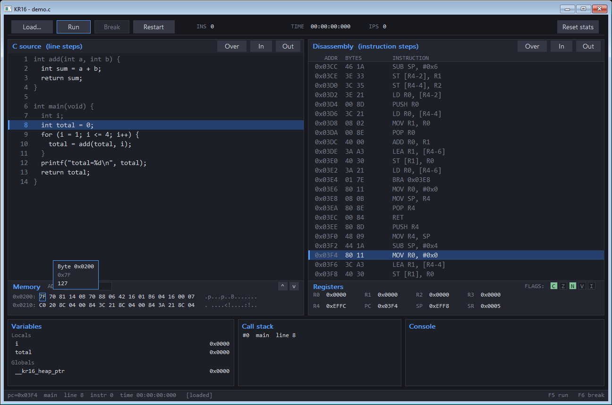

# KR16 — Final Plan (as built)

**A 16-bit teaching computer: ISA, toolchain, runtime, virtual machine, and windowed debugger.**

- Status: **1.0.0 released**, with post-1.0 development on top
- Verified against: source at commit `a6384b4` (2026-10-29)
- Supersedes: [`kr16-plan.md`](kr16-plan.md) as the description of *what exists*.
  That file remains the design history and the source of the original intent.
- Companion documents: [`KR16-Assembly-Language.md`](KR16-Assembly-Language.md)
  (the programmer's manual), [`systemservices.md`](systemservices.md) (the `SYS`
  ABI), [`docs/isa.md`](docs/isa.md) (encoding reference),
  [`implementation.md`](implementation.md) (milestone log),
  [`docs/curriculum.md`](docs/curriculum.md) (teaching path).

---

## 0. How to read this

| If you want… | Read |
|---|---|
| the one-paragraph pitch | §1 |
| to know what changed since the old plan | §2 |
| the high-level architecture | §3 |
| to find a file | §4 |
| the machine (registers, memory, ISA) | §5 |
| what each CLI command does | §6 |
| what the C compiler accepts | §7 |
| what the runtime provides | §8 |
| how programs execute and reach the host | §9 |
| the GUI debugger | §10 |
| the DAP/VS Code integration | §11 |
| the interactive shell | §12 |
| tests, CI, packaging | §13 |
| what is still missing | §14 |
| where the project goes next | §15 |

This is a description of the system that exists, not an aspiration. Where the
old plan and the code disagree, the code won. Section §2 records the
disagreements.

---

## 1. What KR16 is

KR16 is a complete, self-contained teaching computer. One executable contains
an assembler, a linker, a C compiler, a disassembler, a debug-information
dumper, a virtual machine, a Debug Adapter Protocol server, an interactive
shell, and a windowed debugger. A student can write C or assembly, build a
container image, run it, and step through it side by side with the generated
instructions — without installing a toolchain, a VM, or an IDE plugin.

It is not a toy simulator bolted to a real toolchain: the ISA, the object
format, the ABI, the runtime, and the debug format are all designed together,
so every layer is visible and consistent.

```text
   C source ──► cc ──► .s ──► as ──► .o ──┐
                                          ├──► ld ──► .kr16 ──► vm / GUI / DAP
   assembly ──────────► as ──► .o ────────┘
```

Five things make it pleasant to teach with:

1. **Everything is visible.** Disassembly, registers, flags, memory, variables,
   call stack, and console are in one window, and the source line and the
   instruction are highlighted together.
2. **It is deterministic.** RAM is zeroed at reset, execution is instruction
   counted, there is no wall-clock dependence, and console output is
   reproducible.
3. **It fits on one page.** 16-bit words, 64 KiB of address space, eight
   registers, ~50 instructions, a documented memory map.
4. **It is a real toolchain.** Relocatable objects, symbols, relocations,
   sections, a C compiler with an optimizer and debug info, a linker map.
5. **The host is reachable but sandboxed.** File I/O, time, and randomness are
   services with a documented ABI and a sandbox root, not hidden syscalls.

### Ten-minute tour

```text
kr16 build hello.c --run          # compile, assemble, link libc, run
kr16 as boot.s --raw --base 0x0100 -o boot.bin
kr16 ld libc.o hello.o -o hello.kr16 --map hello.map
kr16 size hello.kr16
kr16 dis hello.kr16
kr16 debug hello.kr16 --lines
kr16 vm hello.kr16 --stats
kr16 vm hello.kr16 --trace --trace-syscalls
kr16 dap hello.kr16 --port 22152
kr16                              # windowed debugger (when the UI is built)
kr16 shell                        # interactive shell
```

---

## 2. What changed since `kr16-plan.md`

The original plan described a single-binary CLI toolchain with DAP/VS Code as
the only interactive surface. The system that shipped is broader. These are the
material deltas; each is reflected in the section noted.

| Area | Old plan | Reality |
|---|---|---|
| Interactive surface | DAP + VS Code only | **Windowed debugger** in the binary (Win32 and SDL3), with the shell and DAP beside it (§10) |
| Repository shape | `src/` per tool | `src/` split into engine modules plus `src/platform` (OS boundary) and `src/ui` (portable UI), `tools/mockup` archived (§4) |
| C language | subset without casts | **casts** supported; branch relaxation removed the "big functions do not assemble" limit (§7) |
| Code generation | stack-based only | `-O1` default: constant folding, simple-expression codegen, scalar IR with liveness and graph coloring; `-O0` and `-g` keep the simple backend (§7) |
| Runtime | small libc | libc.s plus **`resources/fileio.c`**, a C file compiled by `kr16 cc`, implementing `SYS` wrappers and an unbuffered stdio (§8) |
| Host services | deferred | **sandboxed filesystem** (`SYS_OPEN`…`SYS_FSINFO`), time and randomness implemented (§9) |
| Heap | bump allocator | **first-fit with coalescing** over a 16 KiB pool, plus in-place `realloc` (§8.3) |
| Debug build | debug lines only | `.debug_line`, `.debug_vars`, `.debug_frames`, `.debug_types`, `.debug_globals`, `.debug_objects`, `.debug_str` (§6.1) |
| Packaging | zip/tar/SHA256 | **AppImage** for Linux x64 and ARM64, single-file Windows exe with embedded fonts and libc (§13.4) |
| Linker symbols | `__heap_start` silently zero | resolved correctly; usable from assembly and C (§8.3) |

---

## 3. Architecture at a glance

```text
┌──────────────────────────── entry points ────────────────────────────┐
│  kr16 <command>        kr16 (no args)         kr16 shell             │
│  CLI dispatcher        windowed debugger      interactive shell      │
└──────────┬────────────────────┬──────────────────────┬───────────────┘
           │                    │                      │
           ▼                    ▼                      ▼
┌──────────────────────┐  ┌────────────────────┐  ┌──────────────────┐
│ CLI commands         │  │ src/ui             │  │ src/dap          │
│ src/cli              │  │ layout, painting,  │  │ DAP over TCP     │
│ as/ld/cc/build/vm…   │  │ hit testing, help  │  │ + JSON           │
└──────────┬───────────┘  └─────────┬──────────┘  └────────┬─────────┘
           │                        │                       │
           │                        ▼                       │
           │              ┌────────────────────┐            │
           │              │ DebugSession       │◄───────────┘
           │              │ src/debug          │  portable debug model
           │              └─────────┬──────────┘
           ▼                        ▼
┌──────────────────────────────────────────────────────────────────────┐
│ kr16_core                                                            │
│  assembler (src/asm)      linker (src/link)      container (src/…)   │
│  compiler (src/cc)        instruction (src/…)    disassembler (src/) │
│  CPU + machine (src/cpu)  VM runner (src/vm)     host services (SYS) │
└──────────────────────────────────┬───────────────────────────────────┘
                                   ▼
┌──────────────────────────────────────────────────────────────────────┐
│ src/platform — the only place OS headers live                        │
│  win32 window/canvas/launcher · SDL3 canvas/window · socket · term   │
└──────────────────────────────────────────────────────────────────────┘
```

Rules the build enforces:

- `src/ui` must not include `windows.h`, `SDL3.h`, GDI types, or assume
  `wchar_t` is UTF-16 (`src/ui/README.md`).
- OS headers are confined to `src/platform` by
  `cmake/CheckPlatformBoundary.cmake`.
- The UI talks to the engine through `DebugSession`, never through `Cpu`,
  `Machine`, or `Container`.

### Module sizes (lines of code)

| Module | Lines | Role |
|---|---:|---|
| `src/cc` | 5,038 | C compiler: lexer, preprocessor, parser, codegen, optimizer |
| `src/ui` | 4,065 | Portable windowed debugger (layout, painting, help, text fields) |
| `src/dap` | 2,328 | DAP server, session, JSON encoding |
| `src/asm` | 2,044 | Assembler: directives, encodings, relaxation, listing |
| `src/platform` | 1,990 | Win32, SDL3, sockets, terminal |
| `src/cli` | 1,889 | Command dispatch, help text, build pipeline, shell |
| `src/vm` | 1,453 | Machine, runner, host services, command line, process |
| `src/debug` | 1,330 | Debug info parsing, `DebugSession` |
| `src/container` | 613 | `.o`/`.kr16` reading and writing |
| `src/cpu` | 577 | CPU core, devices, interrupts, bus |
| `src/instruction` | 553 | Decode/encode tables |
| `src/link` | 471 | Placement, relocation, symbols, map |
| `src/dis` | 321 | Disassembler |
| `include/kr16` | 1,673 | Public headers (30 files) |

Roughly 24,000 lines of engine and UI code, plus ~16,000 lines of tests.

---

## 4. Repository map

```text
CMakeLists.txt            one binary: kr16 (core + ui + cli)
CMakePresets.json         windows-vs2026, windows-ninja(-release),
                          linux-gcc(-release,-sanitize), linux-clang(-release),
                          linux-arm64-cross
cmake/                    platform-boundary check and helpers
include/kr16/             public engine headers + systemservices.h
src/
  asm/ cc/ link/ dis/     the toolchain
  container/              .o and .kr16 format
  cpu/ instruction/       the machine
  vm/                     runner, host services, command line, process
  debug/                  debug info + DebugSession
  dap/                    Debug Adapter Protocol
  ui/                     portable windowed debugger
  platform/               Win32, SDL3, socket, terminal (OS boundary)
  cli/                    command dispatch, build pipeline, shell
  resources/              generated embedded libc/fonts
resources/
  libc.s                  runtime: stdio, strings, heap, exit
  fileio.c                runtime: SYS wrappers + unbuffered stdio (compiled by cc)
  bios.s                  reference BIOS: JMP 0x0100 at 0xF100
  manifest.json           resource names and hashes
  fonts/                  embedded font subsets
  embed_libc.py           regenerates the embedded copy
tests/
  unit/                   22 doctest files (engine, CLI, UI, DAP)
  integration/            hello.c, heap.c, printf_hex.c, assembly fixtures
  golden/                 container fixtures + generator
  support/                heap invariant checker and churn test
  kevin/                  larger programs, including the C-for-U compiler
docs/
  isa.md                  encoding reference
  curriculum.md           teaching path and exercises
  compiler-opt.md         optimization milestones and results
  deferred.md             what is deliberately out of scope
  decisions/              ADR 0001 (16-bit long), 0002 (heap), 0003 (relaxation)
  research/               UI integration plan and screenshots
examples/                 hello.c, sum.c
packaging/linux/          AppImage recipe (AppRun, .desktop, icon)
dist/                      built AppImages (not tracked)
tools/mockup/             archived Win32 reference harness (not built)
```

Narrative documents at the root: the assembly manual, the `SYS` specification,
the debugger walkthrough, the milestone log, and this plan.

---

## 5. The machine

### 5.1 Registers and flags

| Register | Role |
|---|---|
| `R0` | return value, scratch, pair base for `MULS`/`MULU` |
| `R1`–`R3` | first three arguments; `R1` is the high half of an `R0` pair |
| `R4`/`FP` | frame pointer, callee-saved |
| `SP` | stack pointer, full-descending, callee-saved |
| `SR` | flags `C Z N V I` (bits 0–4) |
| `PC` | program counter |

`R0`–`R4` are general; there are five usable scratch registers, which is a real
constraint on runtime code (the heap allocator spills to a frame for this
reason).

### 5.2 Memory map

```text
0x0000  +--------------------------------------------------+
        | hardware vectors  8 × 16-bit                     |     16 B
0x0010  +--------------------------------------------------+
        | BIOS jump table  120 × 16-bit                    |    240 B
0x0100  +--------------------------------------------------+
        | general RAM: code, rodata, data, bss, heap,      | 60 KiB
        | stack                                            |
0xE000  |   … __stack_limit (4 KiB reserve by default) …   |
        |   stack grows down from 0xF000                   |
0xF000  +--------------------------------------------------+
        | memory-mapped I/O                                |    256 B
0xF100  +--------------------------------------------------+
        | BIOS ROM (write-protected while running)         |  3,838 B
0xFFFE  +--------------------------------------------------+
        | reset vector → 0xF100                            |      2 B
0xFFFF  +--------------------------------------------------+
```

Vectors: 0 illegal instruction, 1 breakpoint, 2 divide by zero, 3 timer,
4 keyboard, 5 bus fault, 6–7 reserved. A zero entry halts with an unhandled
exception.

`SP` starts at `0xF000`, must stay even, and the VM raises bus fault 5 if it
leaves `[__stack_limit, 0xF000]`.

### 5.3 Data model

- 16-bit words, **byte-addressed**; 65,536 bytes of address space.
- `int`, `size_t`, `enum`, and pointers are 2 bytes; `long` is a documented
  **16-bit alias** (ADR 0001); `char` is unsigned.
- Little-endian; 2-byte alignment for words, unaligned access is allowed but
  costs a cycle.
- Values are two's complement; shifts by immediate or register (`& 15`).

### 5.4 Instruction set

51 mnemonics across nine formats (`R`, `I`, `M`, `M8`, `B`, `S`, `BIT`, `C`,
`X`). Instructions are 16 bits, or 32 bits for jumps, 16-bit immediates and
displacements.

| Group | Mnemonics |
|---|---|
| Move / memory | `MOV LD LDB LDSB ST STB LEA PUSH POP` |
| Arithmetic | `ADD ADC SUB SBC CMP NEG INC DEC MUL MULS MULU DIV DIVU MOD MODU` |
| Logic / bits | `AND OR XOR TEST NOT SHL SHR SAR BTST BSET BCLR BTOG SEXT ZXTB` |
| Control | `Bcc JMP CALL RET RETI TRAP BRK HLT NOP EI DI WAIT SYS` |

`Bcc` covers `BEQ BNE BCS/BHS BCC/BLO BMI BPL BVS BVC BHI BLS BGE BLT BGT BLE
BAL/BRA`. The assembler **relaxes** out-of-range conditional branches into an
inverted branch plus a long `JMP` (ADR 0003), iterating until the layout stops
moving, so large C functions assemble.

Addressing: register, 6-bit immediate, 8-bit `MOV` immediate, 16-bit immediate,
`[Rs]`, `[Rs+disp6]`, `[Rs+disp16]`, `[addr16]`, PC-relative, and `LEA`. There
is no scaled index and no memory-to-memory operation.

Appendix A has the per-mnemonic summary; [`docs/isa.md`](docs/isa.md) has the
encodings.

### 5.5 Timing

Most instructions are 1–2 cycles. Branches are 1 (not taken) or 2 (taken);
jumps are 3–4; loads and stores are 2, plus 1 when the word address is odd;
`RETI` is 5, exception entry 7, and `SYS` 10. The VM counts cycles and
instructions, reports them with `--stats`, and stops at `--max-cycles`.

### 5.6 Exceptions, interrupts, timer

Vectors 0–5 as above; vector 6–7 reserved. On entry the CPU pushes `SR` then
`PC`, clears `I`, and jumps. `RETI` pops both. Timer 0 has a counter, compare,
prescaler, and a match flag; the keyboard has data, status, and an IRQ enable.
Both are memory-mapped and can be masked in `SR`.

### 5.7 Memory-mapped I/O

| Address | Register |
|---|---|
| `0xF000` | console data (write) |
| `0xF001` | TX ready (always 1) |
| `0xF002` | console echo (bit 0) |
| `0xF004` | keyboard data |
| `0xF005` | keyboard status / overflow clear |
| `0xF006` | keyboard IRQ enable |
| `0xF008` | timer control |
| `0xF00A`/`0xF00B` | timer counter low/high |
| `0xF00C`/`0xF00D` | timer compare low/high |
| `0xF00E` | timer match / clear |
| `0xF010`/`0xF011` | prescaler low/high |
| `0xF012` | IRQ status |

### 5.8 Boot and BIOS

The VM loads the image and the BIOS ROM, sets `PC` from the reset vector
(`0xFFFE` → `0xF100`), and starts. The reference BIOS is four lines: jump to
`0x0100`. `--no-bios` starts at the image entry point, which is what most
teaching runs use.

### 5.9 Calling convention

- Arguments in `R1`, `R2`, `R3`, then the stack at `[FP+4]`, `[FP+6]`, …
- Return value in `R0`; `R1` carries the high half of 32-bit returns.
- `R0`–`R3` and `SR` are caller-saved; `R4`/`FP` and `SP` are callee-saved.
- `PUSH`/`POP` move `SP` by two; frames are `PUSH FP; MOV FP, SP; SUB SP, #n`.
- At entry the VM may provide `argc` in `R1` and `argv` in `R2`.

### 5.10 A first program

```asm
.extern puts
.text
.global _start
_start:
  MOV   R1, #msg
  CALL  puts
  MOV   R0, #0
  HLT

.rodata
msg:
  .asciz "Hello, KR16!"
```

Assemble it with `kr16 as`, then link with `libc.o` for `puts`. The `.extern`
line is required: an undeclared symbol is rejected with `undefined symbol`.

---

## 6. Containers and the toolchain

### 6.1 Container format

One format serves both objects and images, distinguished by kind (`Rel` or
`Exec`) and flagged `HasSymbols`, `HasDebug`, `Stripped`, `HasObjects`.

- magic `"KR16"`, format version 1, kind, entry point;
- sections with name, type (`Progbits`/`Nobits`), flags
  (`Alloc`, `Exec`, `Write`, `Debug`), address, alignment, and contents;
- symbols with binding (`Local`/`Global`/`Extern`), type, visibility, section,
  value, and size;
- relocations `Abs16`, `Pcrel8w`, `Pcrel16w`, `Pcrel16b`;
- debug sections: `.debug_line`, `.debug_sources`, `.debug_vars`,
  `.debug_frames`, `.debug_types`, `.debug_globals`, `.debug_str`;
- an object-file debug payload (`"DBGO"`) carrying per-object records;
- a CRC32 of the payload.

Standard sections: `.crt0`, `.text`, `.rodata`, `.data`, `.bss`, plus debug
sections. `.bss` is `Nobits` and costs no file bytes.

### 6.2 `kr16 as`

`as` assembles one source file into `Rel` or raw binary. It supports `.text`,
`.crt0`, `.rodata`, `.data`, `.bss`, `.section`, `.byte`/`.word`/`.long`,
`.ascii`/`.asciz`, `.align`/`.balign`/`.p2align`, `.space`/`.zero`, `.org`
(raw only), `.equ`/`.set`, `.global`, `.extern`, `.type`/`.size`, `.file`,
`.loc`, `.include`, and `.if`/`.else`/`.endif`.

| Option | Meaning |
|---|---|
| `-o path` | output (default `a.o`, or `a.bin` with `--raw`) |
| `-l path` | listing file |
| `-I dir` | include search directory (repeatable) |
| `-g` | accepted for toolchain compatibility; debug lines come from `.loc` |
| `--raw` | flat binary instead of an object |
| `--base addr` | raw load address (default `0x0100`) |

Multi-pass: it lays out the code, then relaxes out-of-range branches until the
layout stops moving. It stops at the first error; exit 1 on error, 2 on usage
errors.

### 6.3 `kr16 ld`

Lays out `.crt0`, `.text`, `.rodata`, `.data`, `.bss`, then custom sections,
resolves symbols, applies relocations, records the entry point, and writes the
image. It defines `__heap_start` (first address after the image, aligned 2),
`__stack_top` (`0xF000`), and `__stack_limit` (`0xF000 − stack reserve`,
default 4 KiB) — these now resolve correctly in relocations, from assembly and
from C.

| Option | Meaning |
|---|---|
| `-o path` | output image (default `a.kr16`) |
| `--map path` | section and symbol map |
| `--strip-debug` | drop debug sections |
| `--strip` | drop debug sections and all but required symbols |

### 6.4 `kr16 dis`

Disassembles objects and images, with symbols as labels, hex bytes optional,
and a virtual base for raw binaries. Object relocation fields print as zero
(the linker fills them in); linked images show resolved targets.

### 6.5 `kr16 size`

Reports allocatable `.text`, `.data`, and `.bss` for an image or object:

```text
   text    data     bss     dec     hex  file
   6912      19   16486   23417    5b79  hello.kr16
```

### 6.6 `kr16 debug`

Dumps decoded debug information: `--lines`, `--types`, `--vars`, `--frames`,
`--objects`, defaulting to all. This is the tool to reach for when the debugger
shows something unexpected.

### 6.7 `kr16 cc`

Compiles C to assembly, then assembles by default (`-S` stops at assembly).

| Option | Meaning |
|---|---|
| `-S`, `-c`, `-o path` | output control |
| `-g` | debug info (uses the simple backend so variables stay addressable) |
| `-I dir`, `-I<dir>` | include paths |
| `-O0` / `-O1` | optimization level (default `-O1`) |
| `-D`, `-U`, `-std=c99`, `-std=c11` | accepted for compatibility |
| `-E` | unavailable in this subset |

### 6.8 `kr16 build`

The one-step pipeline for a single input: compile `.c` (or assemble `.s`/
`.asm`, or link `.o`), link `libc.s` (and, for C, the compiled `fileio.c`), and
write a sibling `.kr16`. Options: `-o`, `-l`/`-L`/`-l=<path>`/`--listing=<path>`,
`-I`, `-g`/`--no-debug`, `-O0`/`-O1`, `--libc`, `--run`.

`build` writes `x.s`, `x.o`, `x.libc.o`, `x.fileio.o` beside the input; copy
the source elsewhere if that matters.

### 6.9 `version` and `help`

`kr16 version` prints tool, ISA, container, host-ABI, and debug versions
(`kr16 1.0.0 (ISA 1, container 1, host ABI 1, debug 1)`). Every command has
`--help`; `kr16 help <command>` prints the same text.

### 6.10 Diagnostics and listing

Diagnostics are `file:line:column: message` on stderr, one per line, and the
first error stops the tool. `as -l` and `build -l` write a listing that
interleaves addresses, encodings, and source.

---

## 7. The C compiler

### 7.1 Language subset

`int`, `char`, `_Bool`, pointers, arrays, functions and prototypes, `struct`
and `union` (including by-value parameters and returns and aggregate
initializers), `enum`, `typedef`, `static`, qualifiers, `sizeof`, casts,
compound assignment, prefix/postfix `++`/`--`, `if`/`else`, `while`,
`do`/`while`, `for`, `switch`, `goto` and labels, string and character
literals, and `stdarg.h` variadics.

Data model: 16-bit `int`/`long`/pointers, unsigned `char`, 2-byte alignment.

### 7.2 Preprocessor

Object-like and function-like macros, `#`/`##`, `#include` (quoted, angled, and
built-in), `#if`/`#ifdef`/`#ifndef`/`#elif`/`#else`/`#endif`, and
`#define`/`#undef`. Deferred: `#error`, `#line`, pragmas, and variadic macro
definitions.

Built-in headers: `stdio.h`, `stdlib.h`, `string.h`, `stdint.h`, `stddef.h`,
`stdbool.h`, `stdarg.h`, `limits.h`. `<kr16/systemservices.h>` is an ordinary
header from the repository's `include/` directory, found with `-I include`.

### 7.3 ABI

Arguments in `R1`–`R3` then stack; `R0` returns; `R4`/`SP` callee-saved.
Aggregates are copied; struct returns use a caller-provided buffer. Every
function gets a conventional frame so `-g` variables keep stable addresses.

### 7.4 Code generation

| Mode | Behaviour |
|---|---|
| `-O0` | straightforward stack machine codegen; easiest to step |
| `-O1` (default) | constant folding, dead-code cleanup, target-directed simple expressions |
| `-O1` plus scalar IR | liveness/CFG analysis and **graph-colouring register allocation** where supported; initial IR peepholes |

The optimizer milestones are tracked in
[`docs/compiler-opt.md`](docs/compiler-opt.md): M1 and M2 are complete, and the
scalar IR and graph-colouring core are in place (M3/M4 partially; M5 initial).
`-g` deliberately stays on the simple backend so frame-based variables remain
valid.

### 7.5 Debug information

With `-g` the compiler emits `.loc` rows, variable records
(`function|name|offset|size`), frame records, type records, and global
records. The linker relocates line rows by object placement, which is why the
debugger can step source lines in a program whose objects were laid out in any
order.

### 7.6 What C cannot do

No function pointers, no floating point, no 32-bit `long`, no variadic macro
definitions, no `#error`/`#line`/pragmas, and an unresolvable `#include` is
dropped silently (turning unknown names into 0). `-D`/`-U` are accepted but not
applied. See §14.

---

## 8. The runtime

### 8.1 `resources/libc.s`

Assembly runtime. The linker places `.crt0` (emitted by the C compiler) at
`0x0100`, and libc's `.text` follows it:

| Group | Symbols |
|---|---|
| Console | `putchar`, `puts`, `getchar` |
| Formatted output | `printf`/`fprintf`: `%d`, `%i`, `%u`, `%x`, `%X`, `%o`, `%p`, `%c`, `%s`, `%%`, width/padding |
| Strings | `strlen`, `strcpy`, `strcat`, `strcmp`, `memset`, `memcpy` |
| Conversion | `atoi`, `abs` |
| Heap | `malloc`, `calloc`, `realloc`, `free`, `__kr16_heap_used`, `__kr16_heap_peak` |
| Process | `exit` (halts with `R0 = code`) |

### 8.2 `resources/fileio.c`

A C file compiled by `kr16 cc` and linked after `libc.s`. It implements the
`SYS` wrappers (`sys_open`, `sys_read`, …), a 16-byte host-call block, an
8-entry `FILE` table, and an unbuffered `fopen`/`fclose`/`fread`/`fwrite`/
`fgetc`/`fputc`/`fgets`/`fputs`/`fseek`/`ftell`/`rewind`/`fflush`/`feof`/
`ferror`/`clearerr`/`remove`/`rename` layer. It includes
`<kr16/systemservices.h>` from `include/`.

This is a useful milestone in its own right: part of the runtime is C, built by
the project's own compiler.

### 8.3 The heap

First-fit allocator in `libc.s`:

- 2-byte header per block: bit 0 used, size in the remaining bits, size includes
  the header, minimum block 4 bytes;
- address-ordered singly linked free list, links stored in free blocks;
- immediate coalescing on `free`, split only when the remainder can hold a
  block, and the topmost block is handed back so the footprint follows live
  data;
- `realloc` shrinks in place, absorbs a free successor, or extends into
  untouched space when topmost, else moves;
- the pool is a **fixed 16 KiB array** (`__kr16_heap_block` … `__kr16_heap_limit`)
  in `.bss`.

The linker now resolves `__heap_start` and `__stack_limit` correctly, so the
pool could be replaced by the region above the image; that switch has not been
made (§15).

`tests/support/heapcheck.s` is a test-only invariant walker (tiling, sizes,
ordering, coverage, adjacency) and `tests/support/heap_stress.s` runs 400 seeded
malloc/free operations with that checker after each one. Both are linked only by
tests, so the shipped runtime stays small.

### 8.4 Memory budget, measured

`hello.c` with the full runtime, current tree:

```text
0x0100  .crt0                              6 B
0x0106  .text        libc + fileio + main 6,906 B
0x1c00  .rodata                           13 B
0x1c0e  .data                              6 B
0x1c14  .bss         heap pool + statics  16,486 B
0x5c7a  __heap_start
0xE000  __stack_limit
0xF000  __stack_top
```

So a "Hello, KR16!" image is 6.9 KB of code, 19 bytes of data, and a 16 KiB
heap reservation, leaving about 33 KB between the image and the stack.

---

## 9. The host: virtual machine and services

### 9.1 Running programs

| Option | Meaning |
|---|---|
| `--raw`, `--base addr` | load a flat binary at an address |
| `--bios path`, `--no-bios` | choose or skip the BIOS ROM |
| `--max-cycles n` | cycle budget |
| `--realtime`, `--mhz n` | pace execution to a clock rate |
| `--input path`, `--line-input` | scripted or line-buffered guest input |
| `--headless` | no display |
| `--trace`, `--trace-syscalls` | instruction and service tracing |
| `--stats` | cycle and instruction totals |
| `--fs-root`, `--fs-quota`, `--fs-readonly`, `--no-host-fs` | filesystem sandbox |
| `-- args…` | guest arguments |

Exit status is `R0 & 0xFF` on `HLT`, non-zero on VM faults, and the VM prints
the fault kind and `PC`.

### 9.2 Determinism

RAM is zeroed at reset; there is no wall-clock input to the guest except through
`SYS_TIME`, and no host-dependent ordering. Timers advance with simulated
cycles. The same image and the same scripted input produce the same console
output and the same cycle count.

### 9.3 System services (`SYS`)

The guest requests a service by number, passing a 16-byte block:

```text
struct sys_call_block {
    u16 status;      /* result code */
    u16 result[3];   /* service results */
    u16 arg[4];      /* service arguments */
};
```

| # | Service | # | Service |
|---|---|---|---|
| 0 | `SYS_VERSION` | 7 | `SYS_UNLINK` |
| 1 | `SYS_OPEN` | 8 | `SYS_RENAME` |
| 2 | `SYS_CLOSE` | 9 | `SYS_MKDIR` |
| 3 | `SYS_READ` | 10 | `SYS_READDIR` |
| 4 | `SYS_WRITE` | 11 | `SYS_TIME` |
| 5 | `SYS_SEEK` | 12 | `SYS_RANDOM` |
| 6 | `SYS_STAT` | 13 | `SYS_FSINFO` |

The C side lives in `resources/fileio.c`; the authoritative specification,
including argument and result word layouts and status codes, is
[`systemservices.md`](systemservices.md) with the header
`include/kr16/systemservices.h`.

### 9.4 Filesystem sandbox

Guest paths are sandbox-relative. `--fs-root` (default `./sandbox`) sets the
root, `--fs-quota` (default 5 MiB) caps usage, `--fs-readonly` denies writes,
and `--no-host-fs` disables the services entirely. Paths use `/` inside the
sandbox; host absolute paths and `..` escapes are rejected.

### 9.5 Traces and stats

`--trace` prints one line per executed instruction; `--trace-syscalls` prints
each service call with its block; `--stats` prints totals at exit. These are the
primary tools for understanding a failing program without a debugger.

---

## 10. The windowed debugger

On Windows and Linux, `kr16` with no arguments opens the debugger; passing a
`.kr16`, `.c`, `.s`, `.asm`, or `.o` file opens it with that program loaded. It
is one window with these panes:



| Pane | Contents |
|---|---|
| **C source** | source lines with the current line highlighted; breakpoint gutter with a context menu; per-line stepping (Over/In/Out) |
| **Disassembly** | addresses, bytes, instructions, linked to the source line; independent scrolling and step-follow |
| **Registers** | `R0`–`R4`, `PC`, `SP`, `SR`, and the `C Z N V I` flags; editable values |
| **Variables** | locals and globals with addresses and values, typed, with pointer preview and follow |
| **Watches** | user expressions evaluated against the session |
| **Memory** | a memory strip with byte and character columns, adjustable rows, hover detail |
| **Call stack** | frames with function, line, and return address |
| **Console** | guest output, kept separate from the UI |

Top bar: `Load…`, `Run`, `Break`, `Restart`, instruction/time/IPS counters, and
`Reset stats`. A status line reports `pc`, function, line, instruction count,
run time, and state.

Other capabilities: compile-and-link on load (`.c` builds and links libc), error
dialog with diagnostics, settings dialog (including **command-line arguments**
passed as `argv[1..]` with Windows-style quoting), saved `settings.ini`,
instruction and addressing help on hover, theme and font selection, and
scrollbars that can be dragged.

Architecture: `src/ui` is the portable product layer; `src/platform/ui/win32`
(GDI) and `src/platform/ui/sdl` (SDL3 software canvas) are the two backends.
Both embed subsetted JetBrains Mono and Inter, so no fonts need to be installed.
`-DKR16_BUILD_UI=OFF` produces a headless build.

---

## 11. DAP and VS Code

`kr16 dap program.kr16` runs the VM with a Debug Adapter Protocol server on TCP
(port 22152 by default, `--port` to change). It writes an optional readiness
file, reports a stopped/entry event by default (`--no-stop-on-entry` disables),
and accepts `--raw`, `--base`, `--bios`, `--no-bios`.

| Capability | Supported |
|---|---|
| `configurationDone`, `terminate` | yes |
| `readMemory`, `disassemble` | yes |
| `evaluate` for hovers | yes |
| function breakpoints | yes |
| single-thread execution requests | yes |
| conditional breakpoints (`$rN`/`$pc` comparisons) | yes |
| hit-count breakpoints | yes |
| step back | yes |
| restart | yes |
| `setVariable` (registers/globals/locals) | yes |
| delayed stack-trace loading | yes |
| loaded sources, `source` | yes |

The VS Code extension (`vscode/`, "KR16 Debug", 1.2.0) contributes:

- a `kr16` debugger type for `c` and `asm` files with a `launch` request taking
  `program`, `port`, `kr16Path`, `args`, `stopOnEntry`, and `launchAdapter`;
- commands **KR16: Debug Program** and **KR16: Show Disassembly**;
- a disassembly view in the debug toolbar during a session;
- an initial configuration and snippet that target `${workspaceFolder}/build/program.kr16`.

`debug-with-vscode.md` documents installing and configuring the extension.

---

## 12. The shell

`kr16 shell` is the interactive front end that remains available alongside the
GUI:

```text
kr16 C:\work> as hello.s -o hello.o
kr16 C:\work> ld hello.o -o hello.kr16
kr16 C:\work> build hello.c
kr16 C:\work> load hello.c        # build, then run
```

Commands: `cd`, `pwd`, `clear`, `history`, `run`, `help`, `quit`/`exit`, plus
every tool command. History is capped at 100 entries in `~/.kr16_history`.
Piped input runs without prompts, so shell sessions can be scripted. `dap`
refuses to block the shell unless given `--force`.

---

## 13. Tests, CI, and packaging

### 13.1 Suite

| Area | Location | What it covers |
|---|---|---|
| Unit | `tests/unit` (22 files) | assembler, linker, container, CPU, instruction encode/decode, VM, debug info, debug session, DAP, CLI, shell, UI, resources, version |
| Integration | `tests/integration` | `hello.c`, `heap.c`, `printf_hex.c`, assembly fixtures, link fixtures |
| Golden | `tests/golden` | checked-in `exec_min.kr16` and `rel_min.o` plus a generator |
| Support | `tests/support` | heap invariant checker and seeded churn test |
| Larger programs | `tests/kevin` | `C-for-U.c` (a C compiler written in KR16 C), `fileio.c`, `sysfile.c`, `args.c` |

Current totals: **141 doctest cases / 3,446 assertions**, plus **46 CTest
tests**. Labels in use: `unit`, `cli`, `smoke`, `integration`.

`tests/kevin/C-for-U.c` is the most convincing end-to-end test: a C→KR16
assembly compiler written in the KR16 C subset, reading its input through the
sandbox and writing assembly that CTest then assembles, links, and runs.

### 13.2 Running

```text
ctest --preset windows-ninja-debug
ctest --preset linux-gcc-debug
ctest -L integration
```

### 13.3 CI (`.github/workflows/ci.yml`)

| Job | Platform | Configuration |
|---|---|---|
| Windows | `windows-2025` | Debug and Release (Ninja + MSVC) |
| Linux | `ubuntu-22.04` | GCC and Clang, Debug |
| Linux ARM64 | `ubuntu-24.04-arm` | native build and test |
| Sanitize | `ubuntu-22.04` | ASan + UBSan (`KR16_SANITIZE`) |

### 13.4 Packaging and release

- **Windows**: one `kr16.exe`; embeds the font subsets and an embedded copy of
  `libc.s`, so it runs without a `resources/` directory.
- **Linux**: AppImage built by `packaging/linux/package-appimage.sh`, writing
  `dist/KR16-<arch>.AppImage`; contains the GUI, CLI, fonts, and `libc.s`.
- **Release** (`.github/workflows/release.yml`, on a tag): builds Windows x64,
  AppImages for Linux x64 and ARM64, and the VS Code VSIX; writes
  `SHA256SUMS`; then publishes all four assets with `gh release create`.
- **1.0.0** is published with the Windows zip, VS Code VSIX, and `SHA256SUMS`;
  the tagged workflow now produces the same asset set.

Build presets: `windows-vs2026`, `windows-ninja`, `windows-ninja-release`,
`linux-gcc`, `linux-gcc-release`, `linux-gcc-sanitize`, `linux-clang`,
`linux-clang-release`, `linux-arm64-cross`. CMake options: `KR16_BUILD_TESTS`
(default ON), `KR16_BUILD_UI` (on where a backend is available),
`KR16_SANITIZE` (default OFF).

---

## 14. Status and known limits

### Implemented and exercised

ISA and CPU (interrupts, timer, keyboard, bus faults), assembler with
relaxation and listings, linker with map/strip and linker symbols, container
format with symbols and relocations, disassembler, C compiler with casts,
structs by value, varargs, `-O1`, and debug info, runtime with stdio, strings,
heap, and file I/O, VM with raw/BIOS/headless/trace/stats and a filesystem
sandbox, shell, windowed debugger on Windows and Linux, DAP server, VS Code
extension, AppImage and single-exe packaging, and CI on four platforms.

### Deliberately deferred

- Remaining stdio work: `fscanf`, `freopen`, `tmpfile`, and interactive stdin
  buffering. `fprintf`, `setvbuf`, `ungetc`, standard streams, `%p`, `%u`,
  `%o`, width and padding, and the buffered `printf`/`fprintf` formats are
  implemented.
- `errno`, `ctype.h`, `qsort`, `bsearch`, and broad POSIX wrappers.
- Function pointers, floating point, `setjmp`/`longjmp`, signals, locale, wide
  characters.
- True 32-bit `long` (16-bit alias by ADR 0001).
- Full preprocessor: `#error`, `#line`, pragmas, variadic macros.
- Diagnostics for an unresolvable `#include` (currently silent).
- Linker: `--gc-all`, relocatable `-r` links, weak/common symbols, linker
  scripts, embedded release BIOS selection, BIOS RAM loading.
- Distribution: marketplace publication, code signing, installers.

### Known rough edges

- `build` writes intermediates beside the input, which surprises build
  directories and source trees alike.
- `--realtime` is approximate, and the monitor is minimal.

---

## 15. Where this goes next

Ordered by value to the teaching story:

1. **Compiler optimization M3–M5.** Scalar IR, graph coloring, address
   folding, peepholes, and IR spilling are complete; unsupported functions
   still use the documented M2 fallback.
2. **Curriculum pass.** `docs/curriculum.md` links the worked assembly
   examples in `examples/`.

The linker-sized heap is complete: `libc.s` uses `[__heap_start,
__stack_limit)`, and the heap integration test allocates 20,000 bytes.
Undefined symbols are now rejected by the assembler with a source-line
diagnostic. Buffered stdio and the `printf`/`fprintf` formatter are in place;
`fscanf`, `freopen`, and `tmpfile` remain deferred.

---

## Appendix A — Instruction summary

| Mnemonic | Effect |
|---|---|
| `MOV Rd, Rs/#imm` | copy or load immediate |
| `LD Rd,[ea]` / `ST [ea],Rs` | 16-bit load/store |
| `LDB`/`LDSB`/`STB` | byte load (zero/sign extend), byte store |
| `LEA Rd,[ea]` | effective address |
| `PUSH Rs` / `POP Rd` | stack, `SP -= 2` / `SP += 2` |
| `ADD ADC SUB SBC` | add/subtract with carry/borrow |
| `CMP Rd,op` | flags only from `Rd - op` |
| `NEG INC DEC` | negate, increment, decrement |
| `MUL` | low 16 bits of the product |
| `MULS`/`MULU` | 32-bit product into `Rd:Rd+1` |
| `DIV DIVU MOD MODU` | signed/unsigned divide and remainder |
| `AND OR XOR NOT TEST` | bitwise, `TEST` sets flags only |
| `SHL SHR SAR` | logical/arithmetic shifts |
| `BTST BSET BCLR BTOG` | test/set/clear/toggle a bit |
| `SEXT ZXTB` | sign/zero extend a byte |
| `Bcc label` | conditional branch, relaxed when far |
| `JMP`/`CALL` | absolute or register target |
| `RET`/`RETI` | return / return from interrupt |
| `TRAP n` / `SYS` | software trap / host service call |
| `BRK HLT NOP EI DI WAIT` | breakpoint, halt, no-op, interrupt enable/disable, wait |

Branch conditions: `EQ NE CS/HS CC/LO MI PL VS VC HI LS GE LT GT LE AL/RA`.

## Appendix B — Quick command reference

| Command | Purpose |
|---|---|
| `kr16 as <file.s>` | assemble to `.o` (or `--raw` binary) |
| `kr16 dis <file.o\|.kr16>` | disassemble |
| `kr16 cc <file.c>` | compile to `.o` (`-S` for `.s`) |
| `kr16 build <file>` | compile/assemble/link one input |
| `kr16 ld <objs>` | link to `.kr16` |
| `kr16 size <file>` | text/data/bss report |
| `kr16 debug <file>` | dump debug records |
| `kr16 vm <file>` | run with options |
| `kr16 dap <program.kr16>` | DAP server on TCP |
| `kr16 version` | version tuple |
| `kr16 shell` | interactive shell |
| `kr16` | windowed debugger |
| `kr16 help <command>` | per-command help |

## Appendix C — Glossary

| Term | Meaning |
|---|---|
| **container** | the `.o`/`.kr16` file format: sections, symbols, relocations, debug |
| **`.kr16`** | executable container, laid out at final addresses |
| **relaxation** | rewriting a far conditional branch as an inverted branch plus `JMP` |
| **`__heap_start`** | first address after the loaded image, provided by the linker |
| **`__stack_limit`** | bottom of the stack reserve, `0xF000` minus the reserve |
| **`SYS`** | the numbered host-service ABI the guest calls with a 16-byte block |
| **DebugSession** | the portable debug model shared by the GUI, DAP, and tests |
| **sandbox** | the guest-visible filesystem root, quota, and read-only policy |
| **C-for-U** | the C→assembly compiler written in KR16 C and used as an end-to-end test |


