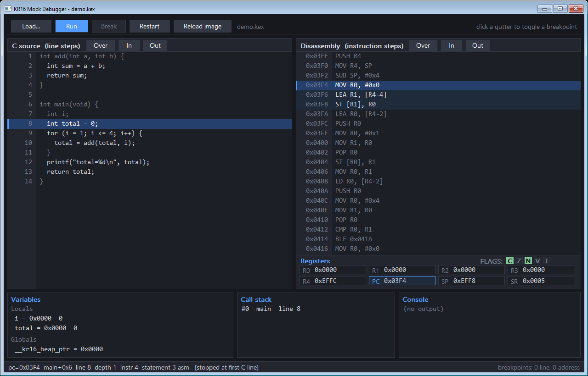
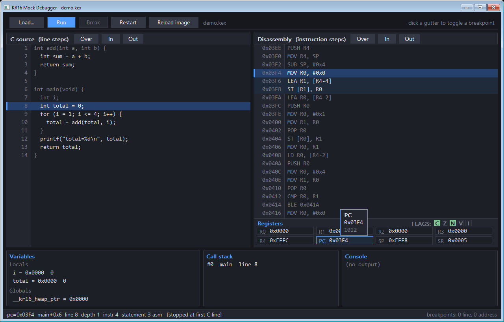
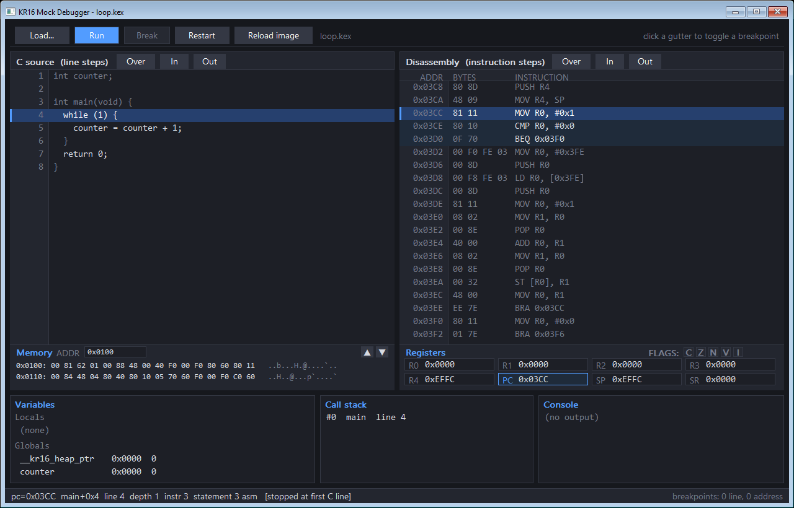
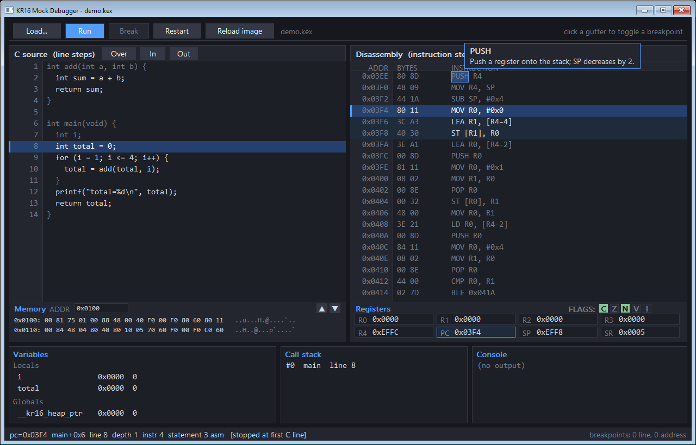
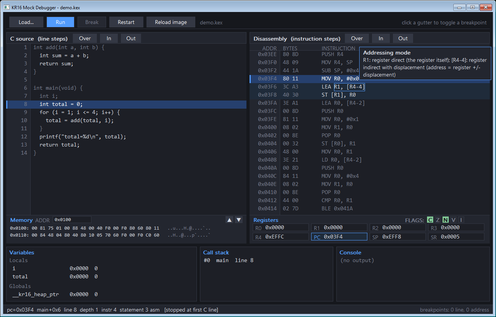
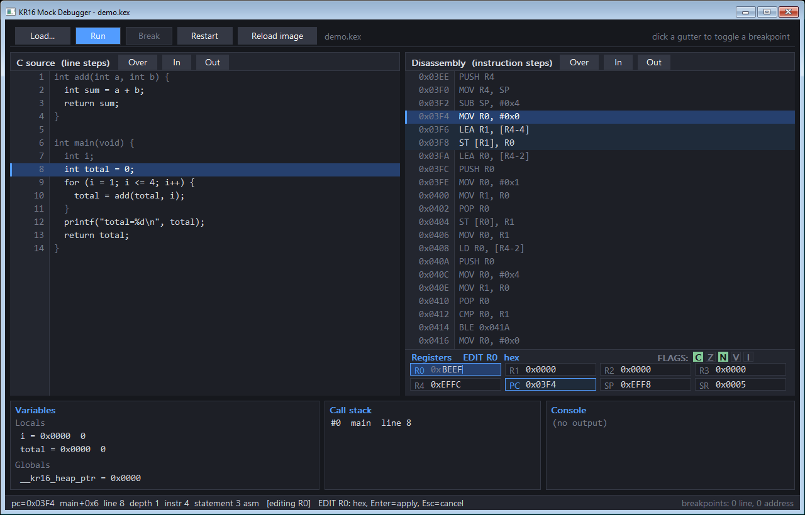
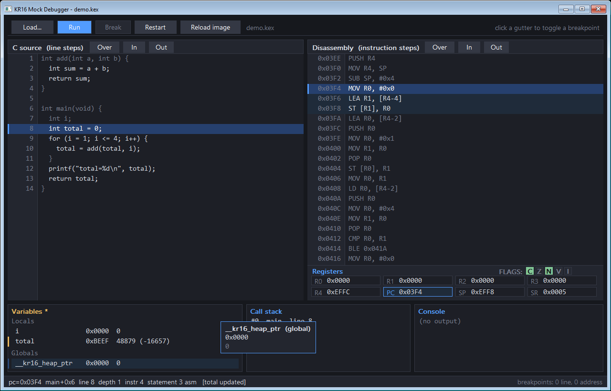
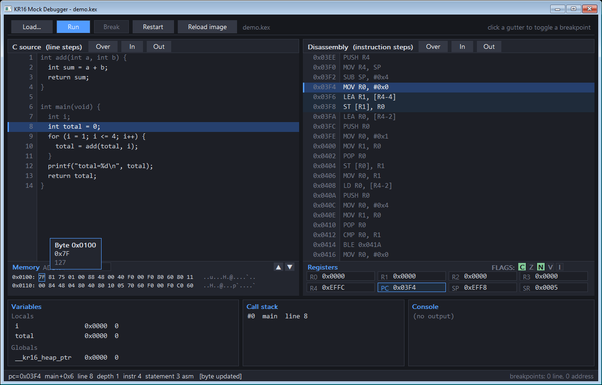

# KR16 windowed debugger (reference implementation)

Approved UI reference for the product, originally used to validate the
visual-debugger idea in
[`docs/research/visual-debugger.md`](../../docs/research/visual-debugger.md).
The integration plan is
[`docs/research/ui-integration-plan.md`](../../docs/research/ui-integration-plan.md).
Until the Win32 port reaches parity, this standalone harness remains the
runnable reference and is not part of the CMake build.



One native Win32 window, one executable, no runtime installs. It links the
existing `kr16_core.lib` and executes a real `.kex`, with:

- a C source pane with its own **Over / In / Out** line-step buttons;
- a disassembly pane with its own **Over / In / Out** instruction-step buttons,
  showing `ADDR`, `BYTES` and `INSTRUCTION` columns;
- hover help in the disassembly: a mnemonic shows what it does, and the operand
  area explains each operand's addressing mode;
- linked highlighting: the current C line, plus the instruction range of that
  statement in the disassembly (and the exact PC in a stronger colour);
- a compact register strip at the bottom of the disassembly pane: R0–R4, PC, SP
  and SR in hex, with a `FLAGS:` group of C/Z/N/V/I boxes that turn green when
  set; hover a register for hex + decimal, or a flag for its name and state;
- click-to-edit registers and click-to-toggle flags (hex only);
- variables (locals and globals) with hover hex/decimal and click-to-edit for
  scalar values; call stack, console output;
- a memory dump at the bottom of the C pane, aligned with the register strip:
  two rows of 16 bytes with ASCII, an editable hex start address, wheel/arrow
  scrolling, and per-byte hover and editing;
- line breakpoints by clicking the C gutter, address breakpoints by clicking the
  disassembly gutter;
- a top bar with **Load…**, **Run**, **Break**, **Restart**, **Reload image**.



The C stepping model is one PC, two granularities. Line steps stop when the
source line changes, with frame depth deciding over/in/out. Non-executable
source lines (`int i;`, braces, comments) are dimmed and a breakpoint on one
snaps forward to the next executable line.

The disassembly's `BYTES` column is a fixed-width field for the 2- or 4-byte
memory-order encoding, so 32-bit instructions do not shift the mnemonic column.



## Instruction and addressing help

Hover a mnemonic to see a one-line description of what the instruction does.



Hover the operand text to see each operand's addressing mode: register direct,
immediate, register indirect, register indirect with displacement, absolute
memory, special register, or a PC-relative branch target.



The help text wraps to a fixed width; it is static educational copy, not derived
from the ISA tables. Operand help lists every operand on the line, not just the
one under the cursor.

## Top bar

| Button | Behaviour |
|---|---|
| **Load…** | File picker. A `.kex` loads directly. A `.c`, `.s`, `.asm` or `.o` is compiled/assembled and linked with the same pipeline as `kr16 build`, then loaded. **C input always links libc**, and this reference build embeds `libc.s` so no `resources\` folder is needed beside the executable. Assembly and object input also link it so calls such as `puts` resolve. Build errors appear in a message box. |
| **Run** | Starts execution in 8 ms time slices, so the window stays responsive. Stops at a line/address breakpoint, on halt, or when **Break** is clicked. |
| **Break** | Stops the running program at the current instruction boundary. The panes and registers then reflect the stopped state and stepping resumes from there. |
| **Restart** | Reloads the current image and stops at the first C line. In-memory register edits are discarded. |
| **Reload image** | Re-reads the current image from disk and clears all breakpoints. |

`kr16_mockup.exe path\to\program.c` (or `.s`/`.asm`/`.o`) also builds and loads on
startup, which is the same path the **Load…** button uses.

## Register editing



- Click a register cell to edit it. The value is **hex only**: digits `0`–`9`
  and `A`–`F`, up to four digits. The `0x` prefix is shown by the cell; typing
  the first digit replaces the old value.
- `Enter` applies; `Esc` cancels. Clicking elsewhere commits a valid edit.
- Click a `FLAGS:` box to toggle that bit. The SR cell updates immediately.
- `SR` only uses bits 0–4 (`C Z N V I`); values above `0x1F` are rejected.
- Any edit marks the strip `Registers *` and outlines edited cells in amber.
  **Restart** or **Load…** clears the mark.
- Edits are in memory only. Editing `PC`, `SP` or `R4` can put the machine in a
  state the source/stack no longer explains; the views degrade to "(no source)"
  or a best-effort stack rather than guessing. There is no undo beyond Restart.

## Variable editing



- Hover a local or global row to show its name, scope, hex value and decimal
  value (signed in parentheses when negative). A `char` also shows its character.
- Click a scalar row to edit it. Input is **hex only**, like registers; `Enter`
  applies and `Esc` cancels.
- Locals are written at `[R4-offset]`, globals at their symbol address.
  `char` values are limited to `0xFF`; `int` values to `0xFFFF`.
- Arrays and structs show `[N bytes]` and are not editable yet: there is no
  element or member type information in the debug data.
- Edited rows get an amber bar and the panel title becomes `Variables *` until
  Restart or Load. Values are read live; the C source pane stays static text.

## Memory



- The memory strip is at the bottom of the C pane and shares its top edge with
  the register strip, so the two line up across the split.
- Two rows of 16 bytes: `0x0100: 00 81 75 ...` followed by 16 ASCII characters.
  Printable bytes show the character; everything else shows `.`.
- The `ADDR` field is editable: click it, type a hex address (maximum `0xFFE0`
  because two rows must fit), and press `Enter`.
- Scroll one row at a time with the mouse wheel over the strip or the `▲`/`▼`
  buttons. The address field follows.
- Hover a byte for its address, hex value and decimal value (plus the character
  for printable bytes). Click a byte to edit it in hex; `Enter` applies and
  `Esc` cancels. A byte edit writes live memory, so editing code bytes changes
  what will execute.
- Unsaved edits are not tracked: Restart or Load reloads the image.

## Build and run

Requires a release build of the toolchain (`kr16_core.lib` and `kr16.exe`) and
`cl.exe`. The script bootstraps `vcvars64.bat` when `INCLUDE`/`LIB` are not set,
so a normal PowerShell works:

```powershell
.\tools\mockup\build.ps1
.\build\mock\kr16_mockup.exe .\build\mock\demo.kex
```

`build.ps1` puts everything under `build\mock\` (git-ignored): the sample
`demo.c`, its `.s`/`.o`/`.kex`, and `kr16_mockup.exe`. Running the executable
without arguments loads `demo.kex` beside it, so double-clicking also works.
The executable embeds the libc source, so loading a `.c` file works even if the
`resources\` folder is not present.

## Controls

| Action | Button | Keyboard |
|---|---|---|
| Run | top bar **Run** | F5 |
| Break | top bar **Break** | F6 |
| Load a program | top bar **Load…** | — |
| C step over | C pane **Over** | F10 |
| C step in | C pane **In** | F11 |
| C step out | C pane **Out** | Shift+F11 |
| Instruction step over | Asm pane **Over** | Ctrl+F10 |
| Instruction step in | Asm pane **In** | Ctrl+F11 |
| Instruction step out | Asm pane **Out** | Ctrl+Shift+F11 |
| Edit a register | click its cell | type hex, Enter/Esc |
| Toggle a flag | click its C/Z/N/V/I box | — |
| Edit a variable | click its row | type hex, Enter/Esc |
| Inspect a variable | hover its row | — |
| Instruction help | hover a mnemonic | — |
| Addressing-mode help | hover the operand text | — |
| Edit memory address | click the `ADDR` field | type hex, Enter/Esc |
| Scroll memory | wheel over the strip, or `▲`/`▼` | — |
| Inspect a byte | hover the byte | — |
| Edit a byte | click the byte | type hex, Enter/Esc |
| Toggle breakpoint | click the gutter | — |
| Scroll a pane | mouse wheel | — |

The status bar shows `pc`, function + offset, line, frame depth, executed
instruction count, instruction count of the current statement, the last action,
and the breakpoint counts. While editing it also shows the hex hint and the
`Enter`/`Esc` keys.

## What to look at

1. Does the dual-toolbar interaction read clearly, or do the two sets of
   Over/In/Out buttons need stronger labels ("step C line" vs "step asm")?
2. Is the statement-range shading in the disassembly enough to connect the two
   views, or does it need a visual bracket/connector?
3. Does dimming non-executable lines help, or is it noise?
4. Does one C step correspond to one statement everywhere: `for` headers,
   `if`, calls, `return`?
5. Is the "C step in at a libc call runs through libc" behaviour confusing?
6. Is click-to-edit on a register discoverable enough, and is hex-only typing
   the right amount of friction for students?
7. Does the `FLAGS:` group make the status bits obvious, and is toggling a flag
   more intuitive than editing `SR`?
8. Does the variables/call-stack strip need to be a full pane (with frame
   selection), or is a compact strip enough?
9. Is variable hover/edit discoverable, and is hex-only the right input for
   variables too, or should variables also accept decimal (for example plain
   `10` or `0x0A`)?
10. Is the two-row memory strip the right size, and does per-byte hover/edit
    feel consistent with the register editor?
11. Does the fixed `BYTES` column read well, and should it show memory-order
    bytes (`00 F0 FE 03`) or 16-bit words (`F000 03FE`)?
12. Are the instruction descriptions at the right level for a student, and does
    the addressing-mode help make the operand syntax clearer?

## Known reference-harness workarounds

These are deliberately in the reference harness, not product fixes:

1. **Source path repair.** The compiler writes raw Windows paths into `.file` /
   `.debug_sources`, and the assembler's string unquoting turns `\r`, `\n` and
   `\t` into control characters. A path containing `\repos` therefore stores a
   carriage return and cannot be opened. The harness turns those control
   characters back into `\r`, `\n`, `\t` for display and file access. The product
   fix is to emit escaped backslashes or forward slashes in `.file`.
2. **Out-of-order line rows are dropped.** The linker relocates `.crt0` line
   rows by `.text`'s placement, so `_start`'s rows land on the first bytes of
   the first C function. Rows that go backwards inside a `.debug_line` section
   are ignored.
3. **Prologue rows that inherit the previous function's last line are set to
   line 0.** Line 0 means "no source statement here", so the first C step lands
   on real code instead of the previous function's last line or a prologue.

Other limitations: single source file (the first `.debug_sources` entry, all
`.debug_line` sections are read but the source table is not per-object),
scalars only (arrays/structs are shown as `[N bytes]` and are not editable),
no frame selection in the call stack, the memory dump is fixed at two rows and
does not follow the PC, no full memory pane, no source editing, no conditional
breakpoints, no undo for register/variable/byte edits, the help text is static
copy (it lists all operands rather than the one under the cursor), and the
keyboard shortcuts need a focused window.

The reference harness also found the path bug above, which affects the existing
VS Code debugger whenever a Windows source path contains `\r`, `\n` or `\t`.

## Files

- `kr16_mockup.cpp` — the whole reference implementation (engine + Win32/GDI
  view).
- `demo.c` — sample program: a loop, a call and `printf`.
- `build.ps1` — builds the demo and the reference UI into `build\mock`.
