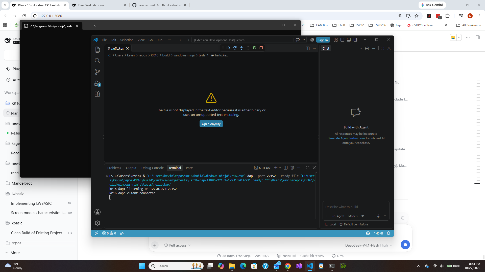

# KR16 VS Code Debugger

Minimal VS Code debug adapter integration for KR16.



## Launch configuration

```json
{
  "type": "kr16",
  "request": "launch",
  "name": "Debug KR16 program",
  "program": "${workspaceFolder}/build/program.kex",
  "stopOnEntry": true,
  "kr16Path": "kr16"
}
```

The extension launches `kr16 dap --port 22152 <program>` in an integrated
terminal, waits for the server readiness marker, and connects the VS Code
debug client. Program output stays in that terminal.

Set `"launchAdapter": false` to attach to an already-running `kr16 dap`
instance; the extension then only connects to the configured port.

The command palette also provides **KR16: Debug Program**, which asks for an
image path and starts a launch session, and **KR16: Show Disassembly**, which
opens a disassembly document around the current PC. The latter is useful
because PlatformIO's Disassembly/Registers/Memory sidebar views only attach to
PlatformIO debug sessions.

## Install for development

Copy this directory into a VS Code extension development host, or package it:

```text
npx @vscode/vsce package
code --install-extension kr16-debug-1.2.0.vsix
```

The debugger supports initialize/launch/configurationDone, source and address
breakpoints, continue, pause, restart, step in/over/out, multi-frame stack walks, loaded sources,
register/global/local scopes, memory, evaluate, disassembly, function-entry
breakpoints, and disconnect.

## Integration test

The extension test launches a real VS Code Extension Development Host and
starts a KR16 debug session:

```text
npm install
KR16_TEST_PROGRAM=<absolute path to hello.kex> \
KR16_TEST_EXE=<absolute path to kr16> \
npm test
```

On Windows PowerShell:

```powershell
$env:KR16_TEST_PROGRAM = (Resolve-Path "..\build\windows-ninja\tests\hello.kex").Path
$env:KR16_TEST_EXE = (Resolve-Path "..\build\windows-ninja\kr16.exe").Path
npm test
```

The adapter writes a readiness marker next to the program after binding its
TCP port; the extension waits for that marker instead of probing the
single-client socket.


